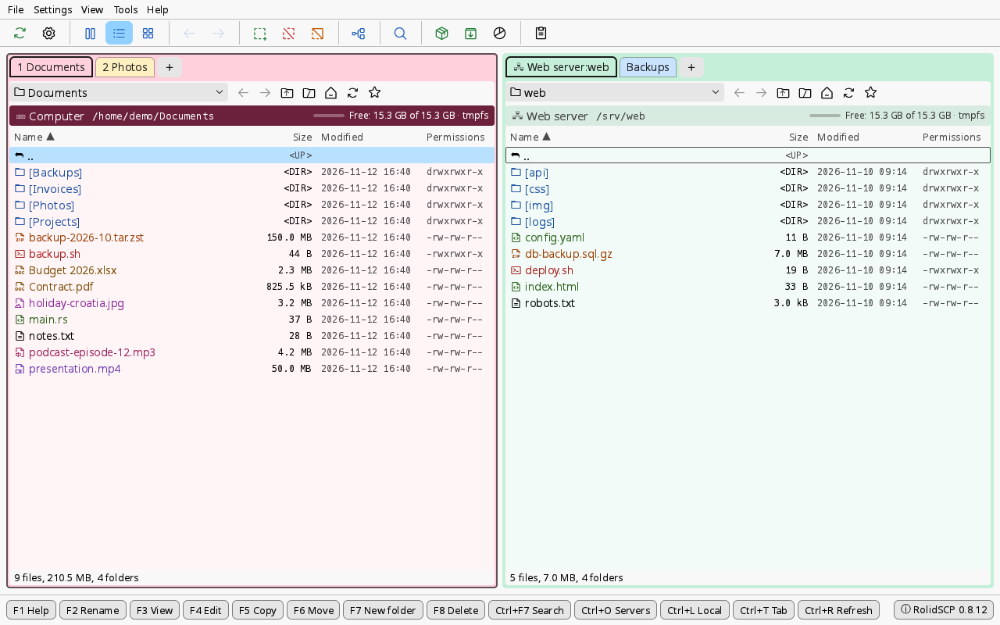

# RolidSCP

A dual-panel file manager for local disks and SFTP servers, inspired by WinSCP and Total Commander.
Written in Rust with an [egui](https://github.com/emilk/egui) GUI. The main idea: **color-coded tabs,
each holding a session**, and fast switching between them.



> **Status:** beta (developer version), Linux only for now. The user interface is in English, Czech,
> German, French, Polish, Spanish, Norwegian (Bokmål) and Danish; the language follows the system and
> can be changed in Settings (see [Translations](#translations)).
> A detailed Czech manual is in [docs/README.cs.md](docs/README.cs.md).

Until 1.0 only the last number of the version goes up (0.8.3, 0.8.4, ...). 1.0 will be the first
production release; until then the window title and the About dialog say "(Beta - developer version)".

## Installation

Packages are attached to every [release](https://github.com/MrRolid/RolidSCP/releases/latest)
(all versions are on the [Releases](https://github.com/MrRolid/RolidSCP/releases) page), together
with `SHA256SUMS` for checking the download (`sha256sum -c --ignore-missing SHA256SUMS`).
All of them are for Linux on 64-bit x86 (amd64 / x86_64).

**Debian, Ubuntu, Linux Mint and other Debian-based systems:** the `.deb` package. apt also
installs the needed libraries:

```sh
sudo apt install ./rolidscp_*_amd64.deb
```

Remove with `sudo apt remove rolidscp`.

**Fedora:** the `.rpm` package:

```sh
sudo dnf install ./rolidscp-*.x86_64.rpm
```

**openSUSE (Leap, Tumbleweed):** the same `.rpm` package. It is not signed, so zypper needs to be
told to accept it:

```sh
sudo zypper install --allow-unsigned-rpm ./rolidscp-*.x86_64.rpm
```

Remove with `sudo dnf remove rolidscp` or `sudo zypper remove rolidscp`.

**Other distributions:** the AppImage, a single file that runs without installation:

```sh
chmod +x RolidSCP-*-x86_64.AppImage
./RolidSCP-*-x86_64.AppImage
```

It contains only the program and uses the graphics, input and font libraries of the system
(X11 or Wayland, EGL or Vulkan, xkbcommon, fontconfig), which every desktop has. It needs FUSE to
run (the `fuse3` package on most systems); without FUSE start it with `--appimage-extract-and-run`.
It does not add itself to the application menu.

- **Supported systems:** glibc 2.35 or newer. Every package of the release is installed or started
  in a clean system by the build ([workflow](.github/workflows/build.yml)): the `.deb` on Debian 12,
  Ubuntu 22.04 and Ubuntu 24.04, the `.rpm` on the current Fedora, openSUSE Leap and openSUSE
  Tumbleweed, the AppImage on Ubuntu 22.04. Newer versions of these systems and distributions based
  on them (e.g. Linux Mint 21 and 22) should work as well; that is a start-up check in a virtual
  display, not a full test. The program itself is developed and used on Debian 13.
  Version 0.8.13 was released before these packages: it has only a `.deb`, which needs Debian 13 or
  Ubuntu 24.04 and newer.
- **Desktop:** X11 is recommended. On Wayland the program runs, but drag and drop with other
  applications (into and out of the window) does not work yet.
- **Start:** "RolidSCP" in the application menu (`.deb`, `.rpm`), or `rolidscp` in a terminal.
- Your settings in `~/.config/rolidscp/` stay when the program is removed.
- Packages of every change on `main` (not released, for testing) are kept for 90 days as artifacts of
  the [build runs](https://github.com/MrRolid/RolidSCP/actions/workflows/build.yml); downloading them
  needs a GitHub account.

## Data safety and error handling

What the program does, and what it does not do, to protect your files. Please read this before you
use it on data that matters: RolidSCP is beta software.

**Copying and moving (F5, F6)**
- A file is written as `name.filepart` and renamed to its real name only when it is complete, so
  an interrupted copy leaves the `.filepart`, never a truncated file under the real name.
  An existing target is replaced in one atomic step where the server offers it
  (`posix-rename@openssh.com`, OpenSSH; always on a local disk). Elsewhere (SFTP version 3 cannot
  rename over an existing file) the old file is first renamed aside to `name.rolidscp-old`, the new
  one takes its name and only then the old one is deleted; the target is never deleted first.
  The step is written to a local journal (`~/.local/state/rolidscp/replace`), so if the connection or
  the program breaks in between, the next connection to that server finishes it (the new file was
  complete) or puts the original back, and tells you which files it concerned.
- After a lost connection the transfer continues from the `.filepart` once the connection is back
  (to a production server only when you confirm it again). This works only while the program runs:
  the queue is not saved, so after a restart or a crash the `.filepart` files stay where they are
  and you have to start the copy again (the conflict choice *Resume* continues them).
- *Resume* continues only a `.filepart` of the same source: for files from 1 MiB on, the source path,
  size and modification time are stored next to it (`name.filepart-info`) and must match. A
  `.filepart` without that record (from another program or an older version) or of another source
  is not resumed: it is left untouched and reported, and you start over with *Overwrite*. A smaller
  one without a record is simply written again. Resuming never appends to the file under the real
  name. The content of the part already transferred is not compared.
- The permission bits (without setuid, setgid, sticky) and the modification time of files are
  copied; failures there are ignored. Folders get their permissions but not their times; the owner
  is not copied.
- A move between different disks or servers is a copy followed by deleting the sources. The sources
  are deleted only when the whole copy succeeded, and each file only when its size and modification
  time are still those it had when it was read, and the target has the same size. With *Verify by
  checksum before deleting the source* (on by default when moving to a server, can be turned off in
  the move dialog) both files are read again and their BLAKE3 checksums compared first. A file that
  changed or whose copy differs stays in the source, and the end of the move says so. A change
  within the same second that keeps the size is noticed only by the checksum. When the copy fails,
  nothing is deleted; files already copied stay in the target.
- Symbolic links: links to folders inside a copied folder are skipped (no loops, nothing from
  outside the tree); links to files are followed, so the file they point to is copied as an ordinary
  file. A move leaves links where they are. The result summary does not list skipped links yet.

**Deleting (F8)**
- Deleting is permanent, locally and on servers. There is no trash and no undo.
- A symbolic link is deleted as a link; the folder it points to is not entered.
- Deleting stops at the first error; what was deleted before stays deleted.

**Editing with F4**
- Saves are noticed after 0.3 s of quiet and uploaded only when the content changed; a save made
  during an upload is uploaded right after it.
- Before each upload the file on the server is compared with the state when you opened it (size and
  modification time, not the content). If it changed, you choose: overwrite, save alongside under
  another name, or cancel. A change that keeps the size within the same second is not detected.
- The upload goes to `name.filepart` first and replaces the file the same way as copying (atomic
  with `posix-rename@openssh.com`, otherwise aside, in place, delete, with the journal). Without
  the extension the name does not exist for a moment; a replacement cut off just then is repaired
  at the next connection.
- When the connection is lost, the upload waits and is tried again when it is back. An upload that
  fails for another reason is tried again twice (after 3 and 10 s), then reported in a message. The
  edited copy is kept, and quitting asks first. "Edited files" and the status bar show "uploaded at
  HH:MM:SS", "uploading…" or the error, so you can see whether the last save arrived.
- Local copies live on disk in `~/.local/state/rolidscp/edit` (folders 0700, files 0600) and are
  deleted when editing ends. After a crash of the program or of the whole computer, changed copies
  are offered for upload at the next start (also those left in `$XDG_RUNTIME_DIR/rolidscp-edit` by
  0.8.13 and older, while that folder still exists).
- Only the permission bits of the server file are kept (not the owner); a symbolic link on the
  server is replaced by a regular file.

**Production servers** (a flag in the server manager)
- Red stripe and a "⚠ PRODUCTION" label on the tab; Enter does not confirm: delete, copy into it
  (F5, dragging between panels, files dropped from another application), move, rename, create a
  folder, permissions, pack and extract into it, upload of every F4 save. The terminal asks first.
- Copying or moving into a production server never starts with *Overwrite*: *Skip existing* is
  preselected instead, whatever the default in the settings.
- An interrupted transfer to a production server is not resumed by itself; you confirm it again.

**Servers and keys**
- Server keys are checked against `~/.ssh/known_hosts` (also hashed entries). A new server shows its
  key type and SHA256 fingerprint and connects only after you trust it; the key is then added to
  that file. A changed key is refused; to accept a new key, remove the old line with
  `ssh-keygen -R <host>`. `/etc/ssh/ssh_known_hosts`, `@cert-authority` and host certificates are not
  supported.
- Login with ssh-agent, a key file (OpenSSH format; PuTTY `.ppk` is read by the SSH library, but not
  yet covered by our tests), the default keys `~/.ssh/id_ed25519`,
  `id_ecdsa`, `id_rsa`, a password or keyboard-interactive. `~/.ssh/config`, jump hosts
  (ProxyJump, ProxyCommand) and importing sessions from WinSCP or FileZilla are not supported yet.
- Saved passwords are in an encrypted vault (`vault.bin`, Argon2id + XChaCha20-Poly1305) behind a
  master password. Locking the vault (by hand or after the set time) does not close connections or
  stop transfers; it forgets the passwords kept for reconnecting. A reconnect then tries ssh-agent
  and keys first and, if the server wants the password, waits with an "Unlock…" button. Passphrases
  of key files are not saved; a reconnect that would need one keeps retrying instead of asking (and
  ssh-agent is not tried when a key file is set in the profile), so for encrypted keys use ssh-agent
  without a key file in the profile.

## Pure SFTP servers and servers with a shell

Everything basic needs only SFTP: browsing, copying, moving, renaming, deleting, permissions,
F3 viewing, F4 editing, archives on a server (downloaded first) and free space (when the server offers
`statvfs@openssh.com`, as OpenSSH does). Some functions are faster when the server also lets RolidSCP
run commands over SSH; when it does not (e.g. `ForceCommand internal-sftp`, a restricted shell or
missing tools), they fall back to SFTP:

| Function | With a shell (commands) | Pure SFTP |
|---|---|---|
| Search (Ctrl+F7) | `find`, `grep`, `xargs` on the server | walks the folders over SFTP and downloads files to search their content (slower; files over 32 MB are not searched by content) |
| Folder sizes | `du` | walks the folders over SFTP |
| Checksums | `md5sum`, `sha1sum`, `sha256sum`, `sha512sum`, `b3sum` | downloads the file and computes locally (CRC32 always so) |
| Search in the F3 viewer | `grep` | reads the file over SFTP |
| File system type in the path row | `df -PT` or `stat -f` | not shown |
| Terminal (Ctrl+P) | the system `ssh` with a login shell | not available |

The fallback is chosen automatically. Search, checksums and the search in the viewer first run a
short check of what the server offers; a server that accepts commands but does not answer that check
within 5 seconds (a login script waiting for input, a stuck profile) is treated as one without a
shell, and the file system type is not shown after 5 seconds. Commands get no input (end of input at
once). Folder sizes run `du` without a check, and a command that stalls after the check (e.g. on a
hung network mount) waits until you cancel it.

## Features

**Panels and tabs**
- Two panels, each with its own tabs (like Total Commander). A tab is one location, a local folder or
  a server, with its own color and name; the panel frame takes the color of its active tab.
  A server can be on either side, and you can copy between two servers.
- Detailed, brief (multi-column) and thumbnail views per tab, folder history (back / forward),
  quick filter by typing (prefix, substring, fuzzy).
- Icons and name colors by file type (configurable, contrast at least 4.5:1 on every tab color),
  optional extension column, dates with seconds, folders in [brackets].
- Columns separated by thin lines; drag a line to resize the column, double click to fit its content.
  The widths are kept per panel; names that do not fit end with "…" and show whole in a tooltip.
- Listings refresh by themselves: local folders are watched (inotify) and show changes from other
  programs at once; server folders (and network disks) refresh when you come back to them if older
  than 5 s and every 30 s while the window is active (View → Automatic refresh). Only what changed
  changes – the cursor, marks, scroll position, sort and computed folder sizes stay.
- A bar above each panel (like WinSCP): a drop-down with the folders on the path from the root and,
  for a local panel, the disks of this computer (Alt+↓), and the buttons Back, Forward, Up, Root
  (Ctrl+\\), Home (Ctrl+H), Refresh and Favorites. It can be hidden in the View menu.
- Free disk space in the path row (a thin bar and "Free: X of Y", locally and over SFTP
  `statvfs@openssh.com`) with the file system type (ext4, btrfs, nfs4, fuse.sshfs…; on a server from
  `df -PT`); in a narrow panel the text gets shorter. Selection summary
  ("Selected: 3 of 95 files, 12.4 MB of 850 MB").
- A right click on the empty space of a panel: new file, new folder, refresh, add the folder to the
  favorites, terminal here, disk properties (free space and SMART).
- Disk health (SMART) of the local disks behind the folder, also through LVM, LUKS and RAID: a badge
  in the path row (a heart-rate icon: grey unknown, green OK, orange or red with the most serious
  reason, e.g. "Wear 87 %") and a detail dialog
  in plain language with advice and all the attributes. Read from UDisks2 without administrator
  rights (or `smartctl` when it runs without them), in the background, at most once a day per disk;
  the temperature is checked every 5 minutes.
- Folder sizes on demand (Alt+Shift+Enter for all, Alt+Space or Shift+Space for the folder under the
  cursor or the marked ones): counted like GNU `du -sb`, on a server with `du` over SSH, otherwise
  by walking over SFTP. Symbolic links are not followed. Sorting and the selection summary use them.
- Ctrl+T opens a menu for the new tab (home folder, favorites, saved servers, recent places, type to
  filter); the tab menu duplicates a tab with its color, renames, recolors and closes other tabs; the
  tooltip of a tab shows the server, user, resolved address and path.
- Favorite folders (Ctrl+D) locally and on servers, under the ★ button of the bar, with names and order;
  the new tab menu always shows them and can add the current folder, rename and remove them.
- Workspace (tabs, colors, paths, favorites, recent places) is saved continuously and restored on start.

**Servers and transfers**
- Server manager (Ctrl+O) with saved profiles, start folder, tab color and a *production server*
  flag (red stripe, warnings, Enter does not confirm dangerous operations; see
  [Production servers](#data-safety-and-error-handling) for what is covered).
- SSH/SFTP via [russh](https://github.com/Eugeny/russh): strict check against `~/.ssh/known_hosts`,
  ssh-agent, keys, password, keyboard-interactive. No `~/.ssh/config` and no
  jump hosts yet.
- Saved passwords live in an encrypted vault (`vault.bin`, Argon2id + XChaCha20-Poly1305) protected
  by a master password, never in plain configuration files. The vault locks again a set time after
  its last use (60 s by default, with a countdown in the status bar) and then also forgets the
  passwords kept for reconnecting.
- Transfer queue (3 at a time), speed limit, `.filepart` files renamed on completion, resume, file
  times and permission bits kept; conflict choice (overwrite, only older, skip, resume) with a
  configurable default.
- Automatic reconnect after a lost connection; interrupted transfers continue from the partial file
  while the program runs (see [Data safety](#data-safety-and-error-handling)).
- Ctrl+P opens the system terminal in the panel's folder; on a server `ssh` into the folder with the
  same strict `known_hosts` check. A password saved in the vault is passed by a one-time
  `SSH_ASKPASS` helper over a private socket (answers only that server's password question, once;
  never on the command line, in the environment, a file or the log); production servers ask first.
- Drag and drop from the system file manager (X11; on Wayland not yet supported by winit).
- Drag files inside the app: to the other panel, onto a folder, `..` or a tab (hold to switch to it);
  Shift moves, Esc cancels; the copy or move dialog always asks first. The target of copying and
  moving is an editable path with the recent targets and a Browse button (local and remote).
- Drag files out of the window to other applications (X11): local files as `text/uri-list` (Shift
  moves); files from a server or an archive are downloaded first, into the target's folder through
  the transfer queue when the target supports XDS (direct save), otherwise into a private temporary
  folder that is deleted when no longer used and at exit. Targets wait only so long for the data
  (GTK about 30 s), so large downloads may not get through the temporary-folder way.

**Files**
- Shift+F4 creates a new file and opens it in the external editor; on a server the file is created
  only by the first save, so closing the editor without saving leaves nothing behind.
- Open with the default application, "Open with..." (applications from `.desktop` files and
  `mimeapps.list`, or a custom command). Programs and scripts are never started without asking;
  files from a server are never executed.
- F3: built-in viewer in a window of its own (several at once). Files of any size open at once and
  are read in blocks: a file on a server is never downloaded whole, a file in an archive is viewed
  through a temporary copy. Text with line numbers, wrapping, encodings (UTF-8, UTF-16, Windows-1250,
  ISO-8859-2, CP852, Windows-1252) and syntax highlighting of 200+ languages; hex mode; follow the end
  of a growing log (also remote); search with the ripgrep engine in the background (text, case, whole
  words, regex), on a server with `grep` over SSH when possible; images (JPEG, PNG, animated GIF, WebP,
  BMP) with zoom, rotation, EXIF orientation and next / previous image of the folder. The viewer never
  runs anything and loads nothing from outside.
- F4: edit in an external editor; a remote file is uploaded back after every save (atomic replace
  when the server offers `posix-rename@openssh.com`, a check whether the file changed on the server,
  recovery after a crash of the program; details in
  [Data safety](#data-safety-and-error-handling)).
- Rename right in the list (F2, Shift+F6): the name without its extension is selected; the edit
  belongs to the item, so sorting or a refresh ends it instead of renaming another item. An existing
  target is replaced only after a confirmation (never a folder), a change of letter case works on
  case-insensitive file systems, production servers ask first. Tabs and files edited with F4 inside a
  renamed folder follow it.
- Move (F6): a rename on the same disk or server; otherwise a copy through the transfer queue, and the
  sources are deleted only after the whole copy succeeded, the target has the same size and the
  source did not change meanwhile (size, modification time); moves to a server also compare BLAKE3
  checksums first (can be turned off).
- Permissions dialog (rwx / octal, recursive with separate file and folder modes).
- Copy names, paths or `sftp://` URLs to the clipboard.
- Search (Ctrl+F7): by name (mask, substring, regex) and content; locally with the ripgrep engine,
  on a server with `find` / `grep` over SSH (falls back to walking over SFTP).
- Checksums: MD5, SHA-1, SHA-256, SHA-512, BLAKE3, CRC32; locally, on a server with coreutils
  `*sum` / `b3sum` over SSH, or by download; copy to the clipboard or save as a file that
  `sha256sum -c` accepts (CRC32 as SFV).

**Archives** (zip, 7z, tar, tar.gz, tar.zst)
- Pack (Alt+F5) with levels Store / Fast / Normal / Maximum and AES-256 passwords for zip and 7z;
  multi-threaded compression for zip, 7z and tar.zst; already compressed files are stored as they are
  in zip; ZIP64 for big archives.
- Extract (Alt+F9) with protection against zip-slip and zip bombs, a code page choice with preview for old zip
  names, test (Alt+Shift+F9).
- Enter on an archive opens it as a read-only folder (also archives on a server, downloaded to a
  temporary folder); F5 copies files out.
- Progress with speed and time left for transfers, packing, extracting and tests.

**Look**
- Built-in Noto Sans font (normal weight made for screens), hinted and drawn on whole pixels.
  In Settings you can pick a system font through fontconfig, the text size (whole points 10–20,
  default 14), hinting strength and text contrast. The default strong hinting puts the vertical
  stems of the letters on whole pixels. Every text size is rounded
  to whole pixels, also at 125 % or 150 % display scale, which comes from the system.
- One dialog look everywhere: a colored title bar with the action icon (drag to move), framed groups,
  aligned labels, longer help in ⓘ tooltips, equal buttons at the bottom right (the default first and
  highlighted, Cancel last); Enter, Esc and Tab work the same in every dialog.
- Toolbar with icons ([Phosphor Icons](https://phosphoricons.com)), function key bar at the bottom,
  every function also in the menus.

## Keyboard

| Key | Action |
|---|---|
| F1 | help (with the list of keyboard shortcuts) |
| Ctrl+Q | quit |
| ↑ ↓ PgUp PgDn Home End | move in the panel |
| ← → | by column in the brief view, by tile in thumbnails |
| Ctrl+F1 / Ctrl+F2 / Ctrl+Shift+F1 | brief / detailed view / thumbnails (per tab) |
| Alt+← / Alt+→ | back / forward in the folder history of the tab |
| Enter / double click | open: folder; archive as a read-only folder; file with the default application (asks for programs and scripts) |
| Shift+Enter | Open with... |
| Backspace | one level up (or delete a filter character) |
| Tab | switch between the left and right panel |
| typing | quick filter, Esc clears it |
| Insert / Space / Ctrl+click | mark an item (Space only marks) |
| Ctrl+A | mark all / none |
| Num+ / Alt+= | mark a group by mask (`*.jpg;*.png`) |
| Alt+− | unmark a group by mask |
| Alt+I | invert the selection |
| Alt+Shift+Enter | size of all folders in the panel |
| Alt+Space / Shift+Space | size of the folder under the cursor or of the marked folders (Shift+Space where the desktop takes Alt+Space, e.g. Cinnamon) |
| right click | context menu |
| F3 | view the file (text, hex, image) |
| F4 | edit in an external editor |
| Shift+F4 | new file in the external editor (on a server it is created by the first save) |
| F2 / Shift+F6 | rename right in the list (Enter confirms, Esc or a click elsewhere cancels) |
| F5 | copy to the other panel |
| F6 | move to the other panel (the target and a new name can be edited) |
| Alt+F5 | pack |
| Alt+F9 | extract |
| Alt+Shift+F9 | test an archive |
| F7 | new folder |
| F8 / Delete | delete permanently (with confirmation; no trash) |
| Ctrl+Shift+A | permissions |
| Ctrl+Shift+N / P / S | copy name / full path / `sftp://` URL to the clipboard |
| Ctrl+G / click on the path | type a path |
| Ctrl+← / Ctrl+→ | open the folder in the left / right panel |
| Ctrl+R | refresh (in search results: search again) |
| Ctrl+F7 / Ctrl+F / Alt+F7 | search files |
| Ctrl+O | server manager |
| Ctrl+L | switch the active panel to the local disk |
| Ctrl+T | new tab: home folder, favorites, servers, recent places |
| Ctrl+W | close tab |
| Ctrl+D | add the folder to the favorites / remove it |
| Alt+↓ | folders on the path and disks (the drop-down of the bar) |
| Ctrl+\\ / Ctrl+H | root folder / home folder |
| Ctrl+Tab / Ctrl+Shift+Tab | switch tabs by last use |
| Ctrl+PgUp / Ctrl+PgDn | previous / next tab |
| Ctrl+1 ... Ctrl+9 | go to tab (9 = last) |
| Ctrl+K | find a tab or a saved server |
| Ctrl+P | terminal in the current folder (on a server: ssh into it) |
| double click on a tab / right click → Rename tab | rename the tab |
| middle click on a tab | close the tab |

## Building from source

For other systems or to try the newest code. On a clean Debian 13 (trixie) or newer:

```sh
sudo apt install build-essential curl git
curl --proto '=https' --tlsv1.2 -sSf https://sh.rustup.rs | sh   # current stable Rust
. "$HOME/.cargo/env"   # load Rust into this shell (new terminals do it themselves)
git clone https://github.com/MrRolid/RolidSCP.git
cd RolidSCP
cargo build --release -p rolidscp
./target/release/rolidscp
```

A C compiler is needed for the bundled C code (zstd, aws-lc). The binary links only to glibc
(libc, libm) and libgcc_s;
X11, Wayland, Vulkan/OpenGL, xkbcommon and fontconfig are loaded at run time, so a desktop with the
usual libraries is enough (the package lists them as dependencies).

Tests: `cargo test --workspace`

The packages are built by scripts in `packaging/`. All of them need `cargo-about` (license
notices of all bundled libraries, refreshed on every build) and `python3`; the `.rpm` also needs
`rpmbuild` (`sudo apt install rpm`), the AppImage `mksquashfs` (`sudo apt install squashfs-tools`)
and downloads the AppImage runtime from a fixed release, checked against its SHA-256:

```sh
cargo install cargo-about --locked --features cli
packaging/build-deb.sh        # target/debian/rolidscp_<version>_amd64.deb
packaging/build-rpm.sh        # target/rpm/rolidscp-<version>-1.x86_64.rpm
packaging/build-appimage.sh   # target/appimage/RolidSCP-<version>-x86_64.AppImage
sudo apt install ./target/debian/rolidscp_*_amd64.deb
```

The packages depend on the glibc version of the build machine; the released ones are built on
Ubuntu 22.04 by the [build workflow](.github/workflows/build.yml), which also runs the tests and
clippy on every push. How a release is made: [docs/releases/README.md](docs/releases/README.md).

The binary is `rolidscp` (`/usr/bin/rolidscp`), with a desktop entry "RolidSCP".

## Translations

The texts are English in the code (gettext style: `tr!("Copy")`, plurals with `trn!`). Every other
language is a gettext file `po/<language>.po`, built into the program. Number, size and date formats
follow the language (Settings can switch dates to ISO). Missing translations show the English text.

| Language | File | State |
|---|---|---|
| English | (in the code) | source |
| Czech | `po/cs.po` | complete, by the author |
| German, French, Polish, Spanish, Norwegian Bokmål, Danish | `po/de.po` … `po/da.po` | **machine translation**, not yet reviewed by native speakers |

The F1 help is in `help/<language>.md` (Markdown, built in; English when a language has none). The
"What's new" notes in About are English, with a Czech version.

**Fixing or adding a language**
- Open `po/<language>.po` in [Poedit](https://poedit.net), Lokalize, GTranslator or any text editor,
  or use an online tool such as [Weblate](https://weblate.org); keep the `{placeholders}` as they are.
- Try it without building: copy the file to `~/.config/rolidscp/lang/<language>.po`. A file there
  wins over the built-in translation (only the messages it translates) and can add a new language
  (e.g. `it.po`), which then appears in Settings → Language. A broken file is ignored with a warning
  in the log.
- For a new language in the repository, copy `po/rolidscp.pot` to `po/<language>.po`, set
  `Language` and `Plural-Forms` in its header, translate, and send a pull request.
- After changing texts in the code, `scripts/update-po.sh` (needs only cargo) extracts them into
  `po/rolidscp.pot`, merges it into every `.po` (new messages come in untranslated, removed ones are
  dropped) and checks placeholders. `cargo run -p rolid-po-tool -- stats` shows how complete each
  language is. A test fails when the code contains text for the user outside the translation.

Machine translations can be wrong or clumsy. Corrections from native speakers are very welcome.

## Configuration and logs

- `~/.config/rolidscp/`: `settings.toml`, `profiles.toml`, `workspace.toml`, `search_history.toml`
  and `vault.bin` (encrypted passwords), all with permissions 0600. `ROLIDSCP_CONFIG_DIR` overrides
  the folder.
- Your own translations: `~/.config/rolidscp/lang/<language>.po`.
- Log: `~/.local/state/rolidscp/rolidscp.log` (Help menu, open log). It never contains passwords.
  Log messages are always English.
  `ROLIDSCP_LOG_DIR` overrides the folder.
- Temporary files: archives in `~/.cache/rolidscp/archive`, files edited with F4 and files dragged
  out to other applications in `~/.local/state/rolidscp/edit` (folders 0700). The journal of
  unfinished replacements on servers is in `~/.local/state/rolidscp/replace`.

## Project layout

```
crates/
  rolid-core     VFS trait, recursive copy, filter, colors
  rolid-local    local file system
  rolid-ssh      SSH (russh) + SFTP (russh-sftp): known_hosts, agent, keys, password
  rolid-config   server profiles, workspace, settings, encrypted vault
  rolid-edit     F4 editing: temporary files, save watching, conflicts, safe upload
  rolid-search   search: local (ignore + grep-searcher), on a server (find/grep), over SFTP
  rolid-archive  archives: pack, list, extract with safety checks, test
  rolid-disk     mounts, file system type, physical disks behind a folder, SMART (UDisks2, smartctl)
  rolid-text     messages for the user as English templates (no translation inside)
  rolid-i18n     translation: built-in .po catalogs, plurals, number and date formats
  rolid-po-tool  developer tool: extract texts into po/rolidscp.pot, merge, check
  rolid-ui       the egui application (binary `rolidscp`)
po/              translations (gettext .po) and the template rolidscp.pot
help/            F1 help pages per language (Markdown)
scripts/         update-po.sh
packaging/       package scripts (deb, rpm, AppImage), desktop entry, icon, cargo-about configuration
docs/            Czech manual, screenshot, release notes (docs/releases/)
.github/         build and release workflow
```

## Security

Please report vulnerabilities privately as described in [SECURITY.md](SECURITY.md), not in a public issue.

## License

Copyright © 2026 Martin Vorel <martin@vorel.eu>.

RolidSCP is free software under the **GNU General Public License, version 3 or later**
(GPL-3.0-or-later), see [LICENSE](LICENSE).

Bundled assets:
- Noto Sans 2.004 font, © 2015 Google LLC, SIL Open Font License 1.1
  (`crates/rolid-ui/assets/fonts/OFL.txt`).
- Hack 3.003 monospace font, © 2018 Source Foundry Authors, © 2003 Bitstream, Inc., MIT and
  Bitstream Vera license (`crates/rolid-ui/assets/fonts/Hack-LICENSE.txt`).
- Phosphor Icons 2.1, © 2023 Phosphor Icons, MIT (`crates/rolid-ui/assets/phosphor/LICENSE`).

The license notices of all Rust libraries built into the binary are in
`/usr/share/doc/rolidscp/copyright` (`.deb`) or `/usr/share/licenses/rolidscp/copyright`
(`.rpm`, and inside the AppImage).
