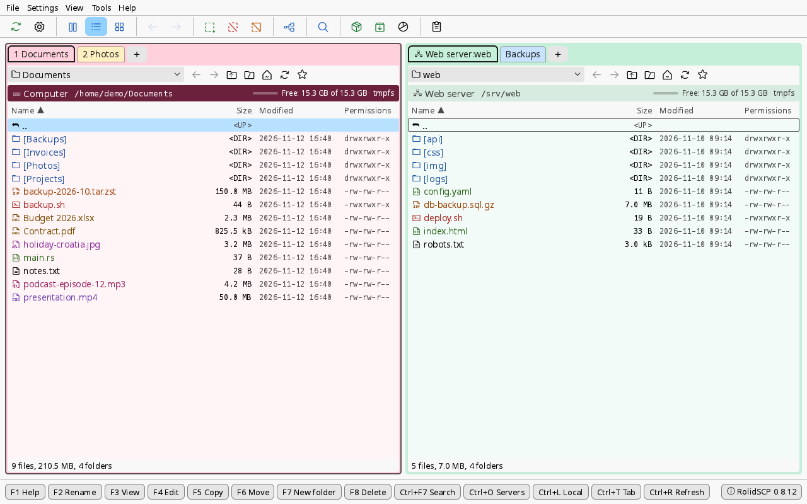

# RolidSCP

Dvoupanelový správce souborů pro lokální disky a SFTP servery, inspirovaný WinSCP a Total Commanderem.
Napsaný v Rustu, GUI v egui. Hlavní myšlenka: **barevně odlišené záložky se session** a rychlé přepínání mezi nimi.



## Instalace

Balíčky jsou přiložené ke každému [vydání](https://github.com/MrRolid/RolidSCP/releases/latest)
(všechny verze jsou na stránce [Releases](https://github.com/MrRolid/RolidSCP/releases)) spolu se
souborem `SHA256SUMS` pro kontrolu staženého souboru (`sha256sum -c --ignore-missing SHA256SUMS`).
Všechny jsou pro Linux na 64bitovém x86 (amd64 / x86_64).

**Debian, Ubuntu, Linux Mint a další systémy odvozené od Debianu:** balíček `.deb`. apt doplní
i potřebné knihovny:

```sh
sudo apt install ./rolidscp_*_amd64.deb
```

Odinstalace: `sudo apt remove rolidscp`.

**Fedora:** balíček `.rpm`:

```sh
sudo dnf install ./rolidscp-*.x86_64.rpm
```

**openSUSE (Leap, Tumbleweed):** stejný balíček `.rpm`. Není podepsaný, zypperu je proto potřeba
říct, že ho má přijmout:

```sh
sudo zypper install --allow-unsigned-rpm ./rolidscp-*.x86_64.rpm
```

Odinstalace: `sudo dnf remove rolidscp` nebo `sudo zypper remove rolidscp`.

**Jiné distribuce:** AppImage, jeden soubor, který běží bez instalace:

```sh
chmod +x RolidSCP-*-x86_64.AppImage
./RolidSCP-*-x86_64.AppImage
```

Obsahuje jen samotný program a používá grafické, vstupní a písmové knihovny systému (X11 nebo
Wayland, EGL nebo Vulkan, xkbcommon, fontconfig), které má každé pracovní prostředí. Ke spuštění
potřebuje FUSE (na většině systémů balíček `fuse3`); bez FUSE ho spusť s
`--appimage-extract-and-run`. Do nabídky aplikací se sám nepřidá.

- **Podporované systémy:** glibc 2.35 nebo novější. Každý balíček vydání se při sestavení
  ([workflow](../.github/workflows/build.yml)) nainstaluje nebo spustí v čistém systému: `.deb` na
  Debianu 12, Ubuntu 22.04 a Ubuntu 24.04, `.rpm` na aktuální Fedoře, openSUSE Leap a openSUSE
  Tumbleweed, AppImage na Ubuntu 22.04. Novější verze těchto systémů a distribuce z nich odvozené
  (např. Linux Mint 21 a 22) by měly fungovat také; jde o kontrolu spuštění na virtuálním displeji,
  ne o úplný test. Samotný program se vyvíjí a používá na Debianu 13.
  Verze 0.8.13 vyšla dřív než tyto balíčky: má jen `.deb` a ten potřebuje Debian 13 nebo Ubuntu
  24.04 a novější.
- **Pracovní prostředí:** doporučené je X11. Na Waylandu program běží, ale tažení souborů mezi ním
  a jinými aplikacemi (dovnitř ani ven) zatím nefunguje.
- **Spuštění:** „RolidSCP“ v nabídce aplikací (`.deb`, `.rpm`), nebo `rolidscp` v terminálu.
- Nastavení v `~/.config/rolidscp/` po odinstalaci zůstane.
- Balíčky každé změny na `main` (nevydané, na zkoušku) jsou 90 dní k dispozici jako artefakty
  [běhů sestavení](https://github.com/MrRolid/RolidSCP/actions/workflows/build.yml); ke stažení je
  potřeba účet na GitHubu.

## Verze

Do verze 1.0 se zvyšuje jen poslední číslo (0.8.1, 0.8.2, 0.8.3 …). Verze 1.0 bude první produkční
verze; do té doby je v titulku okna a v okně O aplikaci označení „(Beta - developer version)“.

## Ochrana dat a chování při chybách

Co program pro ochranu souborů dělá a co nedělá. Než ho použiješ na důležitá data, přečti si to: jde
o beta verzi.

**Kopírování a přesun (F5, F6)**
- Soubor se zapisuje jako `název.filepart` a na skutečný název se přejmenuje až celý, takže přerušené
  kopírování nechá `.filepart`, nikdy useknutý soubor pod skutečným názvem. Existující cíl se vymění
  jedním atomickým krokem, kde to server umí (`posix-rename@openssh.com`, OpenSSH; na místním disku
  vždy). Jinde (SFTP verze 3 neumí přejmenovat přes existující soubor) se starý soubor nejdřív
  přejmenuje stranou na `název.rolidscp-old`, nový zaujme jeho název a teprve pak se starý smaže; cíl se
  nikdy nemaže předem. Krok se zapíše do místního žurnálu (`~/.local/state/rolidscp/replace`), takže
  když se mezitím přeruší spojení nebo program, další připojení k tomu serveru krok dokončí (nový soubor
  byl celý) nebo vrátí originál a řekne, kterých souborů se to týkalo.
- Po ztrátě spojení přenos po obnovení pokračuje od `.filepart` (na produkční server až po novém
  potvrzení). Funguje to jen, dokud program běží: fronta se neukládá, po restartu nebo pádu zůstanou
  soubory `.filepart` na místě a kopírování je potřeba spustit znovu (volba *Navázat* je dokončí).
- *Navázat* pokračuje jen v `.filepart` téhož zdroje: u souborů od 1 MiB se vedle něj ukládá cesta,
  velikost a čas změny zdroje (`název.filepart-info`) a musí souhlasit. `.filepart` bez tohoto záznamu
  (z jiného programu nebo starší verze) nebo z jiného zdroje se nenaváže: zůstane nedotčený, program to
  ohlásí a začneš znovu volbou *Přepsat*. Menší bez záznamu se prostě zapíše znovu. Navázání nikdy
  nepřipisuje do souboru pod skutečným názvem. Obsah už přenesené části se neporovnává.
- Kopírují se práva (bez setuid, setgid, sticky) a čas změny souborů; chyby při jejich nastavení se
  ignorují. Složky dostanou práva, ale ne čas; vlastník se nekopíruje.
- Přesun mezi různými disky nebo servery je kopie a následné smazání zdrojů. Zdroje se smažou jen po
  úspěchu celé kopie a každý soubor jen tehdy, když má pořád velikost a čas změny z doby čtení a cíl má
  stejnou velikost. S volbou *Před smazáním zdroje ověřit kontrolním součtem* (při přesunu na server
  výchozí zapnuto, v dialogu přesunu jde vypnout) se oba soubory nejdřív znovu přečtou a porovnají se
  jejich součty BLAKE3. Soubor, který se změnil nebo jehož kopie se liší, zůstane ve zdroji a konec
  přesunu to ohlásí. Změnu ve stejné sekundě, která zachová velikost, pozná jen kontrolní součet. Když
  kopie selže, nic se nesmaže; už zkopírované soubory v cíli zůstanou.
- Symbolické odkazy: odkazy na složky uvnitř kopírované složky se přeskočí (žádné smyčky, nic mimo
  strom); odkazy na soubory se následují, takže se zkopíruje soubor, na který ukazují, jako obyčejný
  soubor. Přesun nechá odkazy na místě. Souhrn po přenosu přeskočené odkazy zatím neuvádí.

**Mazání (F8)**
- Mazání je nevratné, lokálně i na serveru. Není koš ani zpět.
- Symbolický odkaz se maže jako odkaz; do složky, na kterou ukazuje, se nevstupuje.
- Mazání skončí u první chyby; co se smazalo předtím, zůstane smazané.

**Editace přes F4**
- Uložení se pozná po 0,3 s klidu a nahraje se, jen když se změnil obsah; uložení během nahrávání se
  nahraje hned po něm.
- Před každým nahráním se soubor na serveru porovná se stavem při otevření (velikost a čas změny, ne
  obsah). Když se změnil, vybíráš: přepsat, uložit vedle pod jiným názvem, nebo zrušit. Změna, která
  zachová velikost ve stejné sekundě, se nepozná.
- Nahrává se nejdřív do `název.filepart` a soubor se vymění stejně jako při kopírování (atomicky přes
  `posix-rename@openssh.com`, jinak stranou, na místo, smazat, se žurnálem). Bez rozšíření soubor pod
  svým názvem na okamžik neexistuje; výměna přerušená právě tehdy se opraví při dalším připojení.
- Při ztrátě spojení nahrávání počká a po obnovení se zopakuje. Nahrání, které selže z jiného důvodu,
  se dvakrát zopakuje (po 3 a 10 s) a pak se ohlásí zprávou. Upravená kopie zůstává a ukončení
  aplikace se nejdřív zeptá. „Upravované soubory“ a stavový řádek ukazují „nahráno v HH:MM:SS“,
  „Nahrávám…“ nebo chybu, takže je vidět, jestli poslední uložení dorazilo.
- Lokální kopie jsou na disku v `~/.local/state/rolidscp/edit` (složky 0700, soubory 0600) a po skončení
  úprav se smažou. Po pádu programu i celého počítače se změněné kopie při příštím spuštění nabídnou
  k nahrání (i ty, které v `$XDG_RUNTIME_DIR/rolidscp-edit` nechala verze 0.8.13 a starší, dokud ta
  složka existuje).
- Ze souboru na serveru se zachovají jen práva (ne vlastník); symbolický odkaz na serveru se nahradí
  obyčejným souborem.

**Produkční servery** (příznak ve správci serverů)
- Červený pruh a „⚠ PRODUKCE“ v záložce; Enter nepotvrzuje: mazání, kopírování na něj (F5, tažení mezi
  panely, soubory přetažené z jiné aplikace), přesun, přejmenování, vytvoření složky, práva, balení
  a rozbalení do něj, nahrání každého uložení přes F4. Terminál se nejdřív zeptá.
- Kopírování ani přesun na produkční server nikdy nezačíná volbou *Přepsat*: předvybrané je *Přeskočit
  existující*, ať je v nastavení jakákoli výchozí volba.
- Přerušený přenos na produkční server se sám neobnoví; potvrzuješ ho znovu.

**Servery a klíče**
- Klíče serverů se ověřují proti `~/.ssh/known_hosts` (i hašované záznamy). U nového serveru se ukáže
  typ klíče a otisk SHA256 a připojí se až po potvrzení; klíč se pak do toho souboru přidá. Změněný klíč
  se odmítne; nový klíč přijmeš odstraněním starého řádku přes `ssh-keygen -R <server>`.
  `/etc/ssh/ssh_known_hosts`, `@cert-authority` ani certifikáty serverů podporované nejsou.
- Přihlášení přes ssh-agent, soubor s klíčem (formát OpenSSH; PuTTY `.ppk` načte knihovna SSH, ale naše
  testy ho zatím nepokrývají), výchozí klíče `~/.ssh/id_ed25519`, `id_ecdsa`, `id_rsa`, heslo nebo
  keyboard-interactive. `~/.ssh/config`, skoky přes jiný server (ProxyJump, ProxyCommand) ani import
  relací z WinSCP nebo FileZilly zatím podporované nejsou.
- Uložená hesla jsou v šifrovaném trezoru (`vault.bin`, Argon2id + XChaCha20-Poly1305) za hlavním heslem.
  Zamčení trezoru (ručně nebo po nastavené době) nezavře spojení ani nezastaví přenosy; zapomene hesla
  držená pro znovupřipojení. Znovupřipojení pak zkusí nejdřív ssh-agent a klíče, a když server chce
  heslo, čeká s tlačítkem „Odemknout…“. Hesla k souborům s klíči se neukládají; znovupřipojení, které by
  ho potřebovalo, to zkouší pořád znovu místo dotazu (a ssh-agent se nezkouší, když má profil zadaný
  soubor s klíčem), proto pro zašifrované klíče používej ssh-agent bez souboru s klíčem v profilu.

## Čistý SFTP a servery se shellem

Vše základní potřebuje jen SFTP: procházení, kopírování, přesun, přejmenování, mazání, práva, prohlížení
F3, editace F4, archivy na serveru (nejdřív se stáhnou) a volné místo (když server nabízí
`statvfs@openssh.com`, jako OpenSSH). Některé funkce jsou rychlejší, když server dovolí spouštět příkazy
přes SSH; když ne (např. `ForceCommand internal-sftp`, omezený shell nebo chybějící nástroje), přejdou
na SFTP:

| Funkce | Se shellem (příkazy) | Čistý SFTP |
|---|---|---|
| Hledání (Ctrl+F7) | `find`, `grep`, `xargs` na serveru | prochází složky přes SFTP a kvůli hledání v obsahu soubory stahuje (pomalejší; soubory nad 32 MB se v obsahu neprohledávají) |
| Velikost složek | `du` | prochází složky přes SFTP |
| Kontrolní součty | `md5sum`, `sha1sum`, `sha256sum`, `sha512sum`, `b3sum` | stáhne soubor a spočítá lokálně (CRC32 vždy tak) |
| Hledání v prohlížeči F3 | `grep` | čte soubor přes SFTP |
| Typ souborového systému v řádku cesty | `df -PT` nebo `stat -f` | nezobrazí se |
| Terminál (Ctrl+P) | systémové `ssh` s přihlašovacím shellem | není k dispozici |

Náhradní cesta se volí sama. Hledání, kontrolní součty a hledání v prohlížeči nejdřív krátce
vyzkouší, co server nabízí; server, který příkazy přijímá, ale na tuto zkoušku do 5 sekund neodpoví
(přihlašovací skript čekající na vstup, zaseknutý profil), se bere jako server bez shellu, a typ
souborového systému se po 5 sekundách nezobrazí. Příkazy nedostávají žádný vstup (konec vstupu hned).
Velikost složek spouští `du` bez zkoušky a příkaz, který se zasekne až po zkoušce (např. na zaseknutém
síťovém disku), čeká, dokud ho nezrušíš.

## Jazyky a překlady

Od verze 0.8.7 je program vícejazyčný: angličtina přímo v kódu, další jazyky v souborech gettext
`po/<jazyk>.po` vestavěných do programu. Jazyk se řídí systémem (`LC_ALL`, `LC_MESSAGES`, `LANG`;
nepodporovaný jazyk znamená angličtinu) a lze ho změnit v Nastavení → Jazyk; přepne se hned. Formát
čísel, velikostí a dat odpovídá jazyku (čeština: `08.11.2026 21:08`, `38,1 MB`), volba Formát data
umí přepnout na ISO (`2026-11-08 21:08`). Chybějící překlad se zobrazí anglicky.

- Jazyky: angličtina, čeština, němčina, francouzština, polština, španělština, norština (bokmål),
  dánština. Kromě češtiny jde o **strojový překlad**, který zatím nezkontroloval rodilý mluvčí.
- Vlastní nebo opravený překlad: soubor `~/.config/rolidscp/lang/<jazyk>.po` má přednost před
  vestavěným (jen u zpráv, které překládá) a může přidat i nový jazyk. Poškozený soubor se ignoruje
  s varováním v logu. Úpravy jdou v Poeditu, Lokalize nebo na Weblate.
- Nápověda F1 je v `help/<jazyk>.md`; okno O aplikaci ukazuje novinky anglicky, v češtině česky.
- Log je vždy anglicky.
- Vývoj: texty v kódu píšou `tr!("Copy")`, množné číslo `trn!("{n} file", "{n} files", n)`,
  knihovny vracejí `Text` (anglická šablona) a překládá je až UI. `scripts/update-po.sh` (stačí cargo)
  vytáhne texty do `po/rolidscp.pot` a sloučí je do `.po`; test selže, když v kódu zůstane text pro
  uživatele mimo překlad.

## Ovládání

Všechny funkce jsou v menu **Soubor · Nastavení · Zobrazit · Nástroje · Nápověda** a spodní lišta má klikací tlačítka (jako v Total Commanderu).
Verze aplikace je vidět vpravo v menu, v titulku okna a v Nápověda → O aplikaci.

| Klávesa | Akce |
|---|---|
| F1 | nápověda (a přehled klávesových zkratek) |
| Ctrl+Q | konec |
| ↑ ↓ PgUp PgDn Home End | pohyb v panelu |
| ← → | o sloupec ve stručném výpisu, o dlaždici v miniaturách |
| Ctrl+F1 / Ctrl+F2 / Ctrl+Shift+F1 | stručný / podrobný výpis / miniatury (každá záložka zvlášť, pamatuje se) |
| Alt+← / Alt+→ | zpět / vpřed v historii složek záložky |
| Enter / dvojklik | otevřít: složku; archiv jako složku jen pro čtení; soubor výchozí (nebo zapamatovanou) aplikací; u programu nebo skriptu se zeptá (Otevřít v editoru / Spustit / Zrušit) |
| Backspace | o úroveň výš (nebo smazat znak filtru) |
| Tab | přepnout levý/pravý panel |
| psaní znaků | rychlý filtr (prefix → podřetězec → fuzzy), Esc zruší |
| Insert / Mezerník / Ctrl+klik | označit položku (mezerník jen označuje) |
| pravý klik na soubor | kontextové menu (otevřít, otevřít s, upravit, kopírovat, smazat, práva, zabalit, rozbalit, test archivu, velikost složek, kontrolní součty, do schránky, označit) |
| Shift+Enter | Otevřít s… (výběr aplikace nebo vlastní příkaz) |
| Ctrl+Shift+A | práva (rwx / osmičkově, i rekurzivně) |
| Ctrl+Shift+N / P / S | do schránky: název / celá cesta / `sftp://uživatel@server:port/cesta` (bez hesla) |
| F3 | zobrazit soubor ve vestavěném prohlížeči (text, šestnáctkově, obrázek) |
| F4 | upravit soubor v externím editoru (ze serveru se po každém uložení sám nahraje zpět) |
| Shift+F4 | nový soubor v externím editoru (na serveru vznikne až prvním uložením) |
| Ctrl+A | označit vše / zrušit |
| Num+ / Alt+= | označit skupinu podle masky (`*.jpg;*.png`, historie posledních masek) |
| Alt+− | odznačit skupinu podle masky |
| Alt+Shift+Enter | spočítat velikost všech složek v panelu |
| Alt+Space / Shift+Space | spočítat velikost složky pod kurzorem (nebo všech označených složek); Shift+Space pro prostředí, kde Alt+Space otevírá menu okna (Cinnamon) |
| Alt+I | invertovat výběr souborů (i složek, když to zapne Nastavení) |
| F2 / Shift+F6 | přejmenovat položku pod kurzorem přímo v seznamu (Enter potvrdí, Esc nebo klik jinam zruší) |
| F5 | kopírovat označené (nebo pod kurzorem) do druhého panelu |
| F6 | přesunout označené (nebo pod kurzorem) do druhého panelu; cíl i nový název jde upravit |
| Alt+F5 | zabalit označené (zip, 7z, tar, tar.gz, tar.zst; heslo u zip a 7z) |
| Alt+F9 | rozbalit označené archivy |
| Alt+Shift+F9 | otestovat archiv |
| F7 | nová složka |
| F8 / Delete | smazat nevratně (s potvrzením; bez koše) |
| Ctrl+G / klik na cestu | zadat cestu (`~`, relativní i absolutní) |
| Ctrl+← / Ctrl+→ | otevřít adresář v levém / pravém panelu |
| Ctrl+R | obnovit (ve výsledcích hledání: hledat znovu) |
| Ctrl+F7 / Ctrl+F | hledat soubory (název, obsah, velikost, datum); Alt+F7 funguje také, pokud ho nezachytí správce oken |
| Ctrl+O | správce serverů: uložené profily, rychlé připojení do aktivního panelu |
| Ctrl+L | přepnout aktivní panel na lokální disk |
| Ctrl+T | nabídka nové záložky: domovská složka, oblíbené, servery, poslední místa (psaním filtr) |
| Ctrl+W | zavřít záložku v aktivním panelu |
| Ctrl+D | přidat složku do oblíbených / odebrat ji |
| Alt+↓ | složky na cestě a disky (rozbalovací pole lišty nad panelem) |
| Ctrl+\\ / Ctrl+H | kořenová složka / domovská složka |
| Ctrl+Tab / Ctrl+Shift+Tab | přepínání záložek aktivního panelu podle posledního použití (drž Ctrl a opakuj Tab) |
| Ctrl+PgUp / Ctrl+PgDn | předchozí / další záložka |
| Ctrl+1 … Ctrl+9 | skok na záložku (9 = poslední) |
| Ctrl+K | hledání záložky nebo uloženého serveru (otevře ho, nebo přepne na jeho záložku) |
| Ctrl+P | terminál ve složce panelu; na serveru `ssh` do této složky s uloženým heslem |
| dvojklik na záložku / pravý klik → Přejmenovat záložku | přejmenovat záložku (prázdný název = automatický) |
| pravý klik na záložku | barva: 16 pastelů nebo libovolná (HSV / hex), zavřít |
| prostřední klik na záložku | zavřít záložku |

## Servery, pracovní prostor, přenosy

- **Záložky má každý panel vlastní** (jako Total Commander). Každá záložka je jedna lokace, místní složka
  nebo server, a má vlastní barvu a název. Rám panelu má barvu jeho aktivní záložky, takže je hned
  vidět, kde jsi. Server může být vlevo i vpravo a kopírovat jde i mezi dvěma servery. Data tečou přes
  tento počítač po blocích, bez dočasných souborů.
- **Omezení rychlosti přenosů** (dialog kopírování, stavový řádek během přenosu, menu Nastavení) platí
  pro všechny přenosy dohromady a jde měnit i za běhu. Hodí se, aby přenos nezahltil pomalou linku.

- **Správce serverů (Ctrl+O):** uložené profily s názvem, výchozí složkou, barvou záložky a příznakem
  *produkční server*. Produkce má červený pruh v hlavičce, varování v záložce i v dialozích a mazání
  na ní nejde potvrdit Enterem (co všechno je chráněné, viz [Ochrana dat](#ochrana-dat-a-chování-při-chybách)). Heslo se volitelně ukládá do šifrovaného souboru chráněného
  **hlavním heslem** (viz níže), nikdy do konfiguračních souborů.
- **Hlavní heslo** (Nastavení → Hlavní heslo): vytvoří se při prvním uložení hesla k serveru.
  Musí mít aspoň 10 znaků, 2 velká písmena a číslici nebo jiný znak než písmeno a nesmí být snadno
  uhodnutelné (běžná hesla, opakování, řady jako `123456`/`qwerty`, název aplikace, uživatelské jméno;
  zxcvbn skóre aspoň 3/4). Po startu se zeptá jen při prvním použití uloženého hesla; připojení bez
  uložených hesel se na nic neptá. Zamknutí ručně („Zamknout teď“, tlačítko 🔒/🔓 dole vpravo) nebo po
  nastavené době od posledního použití (30 s až 1 h, výchozí 1 min, nebo nikdy). Změna hlavního hesla soubor atomicky přešifruje. **Zapomenuté hlavní
  heslo nejde obnovit** – jde jen „Smazat uložená hesla a začít znovu“ (profily zůstanou, bez hesel).
  Hesla uložená do systémové klíčenky verzemi 0.3–0.4.1 aplikace po startu nabídne přesunout; z klíčenky
  se smažou až po úspěšném zápisu a ověřeném přečtení nového souboru.
- **Pracovní prostor:** záložky, jejich názvy, barvy a cesty se ukládají průběžně a po spuštění se obnoví.
  Vzdálené panely se připojí, až když se jejich záložka zobrazí. Když přihlášení selže, otevře se
  správce serverů s vyplněnými údaji.
- **Přenosy:** fronta (nejvýše 3 souběžně, další čekají), rychlost, zrušení. Soubor se zapisuje do
  `název.filepart` a po dokončení se přejmenuje. Zachovává se čas změny a práva souborů (u složek jen
  práva, vlastník ne; viz [Ochrana dat](#ochrana-dat-a-chování-při-chybách)). Při kopírování
  se volí, co s existujícími soubory: přepsat, přepsat jen starší, přeskočit, nebo navázat přerušený přenos.

## Přejmenování a přesun (F2, Shift+F6, F6)

- **Přejmenování přímo v seznamu:** F2, Shift+F6, Soubor → Přejmenovat nebo kontextová nabídka. Pole
  obsahuje celý název; u souboru je označená část bez přípony (`zprava` z `zprava.txt`), u složky celý
  název. Enter potvrdí, Esc, klik jinam nebo jiná ztráta zaměření zruší.
- Úprava patří k položce (složka + název), ne k číslu řádku: změna řazení, obnovení, rychlý filtr,
  přepnutí záložky nebo odchod ze složky ji ukončí, takže se nikdy nepřejmenuje jiná položka.
- Název nesmí být prázdný, „.“, „..“, s lomítkem, se znakem NUL ani delší než 255 bajtů; chyba se ukáže
  hned pod polem a jde opravit. Když položka s novým názvem existuje, aplikace se zeptá; přepíše jen soubor
  souborem a jen po výslovném potvrzení (Enter tu nepotvrzuje), přes složku nabídne jen Zrušit. Zrušit vrátí
  do pole s napsaným názvem. Změna jen velikosti písmen (`readme` → `README`) jde přes dočasný název, takže
  funguje i na souborových systémech, které velikost písmen nerozlišují.
- Lokálně je to obyčejné přejmenování, na serveru SFTP rename (přepsání atomicky přes
  `posix-rename@openssh.com`, když ho server nabízí). Na produkčním serveru se vždy nejdřív zeptá.
  V archivu přejmenování odmítne.
- Po přejmenování zůstane kurzor na položce a ostatní označení se nezmění. Záložky, které ukazují do
  přejmenované složky, se přesunou s ní; soubory upravované přes F4 se dál nahrávají na nové místo
  (když se zrovna nahrával, aplikace upozorní).
- **Přesun (F6):** označené položky nebo položka pod kurzorem do druhého panelu. Dialog jako u F5
  s upravitelnou cílovou cestou; u jedné položky je na konci cesty její název a jde změnit (lomítko na
  konci = do té složky se stejným názvem). Volba u existujících souborů je stejná jako u F5 včetně
  předvolby z Nastavení.
- Na stejném disku nebo serveru se položky jen přejmenují (okamžitě, i velké soubory). Mezi disky nebo
  servery se zkopírují přes frontu přenosů a zdroj se smaže až po úspěšném dokončení celé kopie, a jen
  soubory, které v cíli mají stejnou velikost a jejichž velikost ani čas změny se ve zdroji mezitím
  nezměnily. Volba *Před smazáním zdroje ověřit kontrolním součtem* (při přesunu na server výchozí
  zapnuto) navíc porovná kontrolní součty zdroje a kopie. Při chybě nebo zrušení zdroj zůstane. Soubor přeskočený podle volby u existujících souborů zůstane ve zdroji i se složkou;
  symbolické odkazy se mezi disky nepřesouvají.
- Produkční zdroj nebo cíl se v dialogu vyznačí a Enter pak nepotvrzuje; na produkční cíl se nikdy
  nepředvybírá *Přepsat*. Z archivu jde jen kopírovat
  ven: F6 otevře kopírování.

## Prohlížeč (F3)

- F3, Soubor → Zobrazit, kontextové menu nebo tlačítko **F3 Zobrazit** dole. Každý prohlížeč je
  samostatné okno (lze jich mít otevřeno víc); kde systém více oken neumí, egui ho vykreslí uvnitř
  hlavního okna.
- **Velké soubory** se čtou po blocích (lokálně `pread`, ze serveru rozsahy přes SFTP s čtením
  dopředu), mezipaměť všech prohlížečů má nejvýš 256 MB. První obrazovka je hned, řádky se počítají na
  pozadí; do té doby jsou čísla řádků s `~` odhad. Na serveru se řádky počítají jen v prvních 64 MB
  (dál odhad), aby se soubor nestahoval celý. Skok na konec je okamžitý; řádek dlouhý stovky MB se
  ukazuje po částech (↪). Soubor z archivu se prohlíží přes dočasnou kopii.
- **Kódování**: UTF-8, UTF-16 podle BOM, jinak odhad (i poškozené UTF-8); menu Kódování přepne na
  UTF-8, UTF-16 LE/BE, Windows-1250, ISO-8859-2, CP852 nebo Windows-1252.
- **Text**: W zalamování, N čísla řádků, Ctrl+plus/minus nebo Ctrl+kolečko velikost písma, Ctrl+G skok
  na řádek / procento / pozici (0x…), Ctrl+Home / Ctrl+End. Výběr myší (dvojklik = slovo) nebo
  Shift+šipkami, Ctrl+C kopíruje do schránky (nejvýš 32 MB, větší výběr se čte na pozadí).
- **Zvýraznění syntaxe** (syntect, 213 jazyků) podle přípony nebo prvního řádku, ruční volba v menu
  Zvýraznění; počítá se jen viditelná oblast se stavem uloženým po úsecích, takže skok doprostřed je
  rychlý. Nad 20 MB (Nastavení → Prohlížeč (F3)) nebo u extrémně dlouhých řádků se samo vypne a
  stavový řádek to řekne.
- **Sledování konce** (F) i na serveru; posun kolečkem nahoru ho pozastaví. Změna souboru → lišta
  Načíst znovu / Sledovat konec. Ztráta spojení → lišta jako v panelu a po obnovení se pokračuje.
- **Šestnáctkový režim** (2), u binárních dat automaticky s lištou „Zobrazit jako text“.
- **Hledání** (Ctrl+F / F7): text, Aa (velikost písmen), celá slova, regulární výraz; F3 / Shift+F3
  (i Enter / Shift+Enter v poli) další / předchozí. Prohledává se celý soubor na pozadí jádrem
  ripgrepu (od zobrazeného místa do konce a pak od začátku), počet roste průběžně, tlačítko Zrušit.
  Na serveru se nejdřív zkusí `grep -b -o` přes SSH (zkušebním spuštěním se ověří, že ho server má a
  že umí potřebné volby; vzor i cesta jsou bezpečně v uvozovkách); jinak se soubor čte přes SFTP.
  Lišta ukáže „grep na serveru“ nebo „čteno přes SFTP“.
- **Obrázky** (3; JPEG, PNG, GIF i animovaný, WebP, BMP): F přizpůsobit oknu, 0 = 100 %, kolečko
  zoom, tažení posun, dvojklik přepne 100 % / přizpůsobit, R / L otočí zobrazení, EXIF orientace se
  použije. Šipky, PgUp/PgDn, mezerník a Backspace = další / předchozí obrázek ve složce v pořadí
  panelu. Dekóduje se na pozadí s limity jako u miniatur (nejvýš 10 000 px na stranu, 200 MB
  paměti); ze serveru se stahuje jen do 50 MB (Nastavení → Prohlížeč (F3)) s průběhem.
- **Bezpečnost**: prohlížeč nic nespouští a nic nenačítá zvenčí; HTML, XML i SVG ukazuje jako text.
- F4 v prohlížeči otevře soubor v editoru stejně jako F4 v panelu; Esc nebo Q prohlížeč zavře.

## Editace v externím editoru (F4)

- F4, Soubor → Upravit v externím editoru, kontextové menu nebo tlačítko **F4 Upravit** dole.
- **Nový soubor Shift+F4** (také Soubor → Nový soubor… a kontextové menu): jméno pod kurzorem je
  předvyplněné (označené bez přípony), platí stejné kontroly jako u přejmenování. Lokálně prázdný soubor
  vznikne hned; na serveru až prvním uložením v editoru (u produkčního serveru s potvrzením), zavření
  editoru bez uložení nic nevytvoří. Existující jméno otevře ten soubor k úpravě s upozorněním. V archivu
  a ve výsledcích hledání nejde. Po vytvoření se panel obnoví s kurzorem na novém souboru.
- **Lokální soubor** se otevře přímo (bez kopie).
- **Soubor ze serveru** se stáhne do soukromé složky na disku (`~/.local/state/rolidscp/edit`, práva 0700,
  každý soubor ve vlastní podsložce, původní název i přípona) a otevře se v editoru. Aplikace hlídá
  složku (zachytí i „atomické“ uložení přes dočasný soubor a přejmenování) a po ~300 ms klidu porovná
  obsah. Při skutečné změně soubor nahraje přes frontu přenosů: zapíše `název.filepart`, ověří velikost,
  nastaví původní práva a teprve pak nahradí originál. Pokud server umí `posix-rename@openssh.com`
  (OpenSSH ano), výměna je jeden atomický krok. Jinak se originál nejdřív přejmenuje na
  `název.rolidscp-old`, nový soubor zaujme jeho místo a starý se smaže (při chybě se originál vrátí;
  výměnu přerušenou ztrátou spojení nebo pádem dokončí nebo vrátí další připojení k serveru).
  Při chybě na serveru nezůstane useknutý soubor; bez `posix-rename` ale na okamžik soubor pod svým
  názvem neexistuje (viz [Ochrana dat](#ochrana-dat-a-chování-při-chybách)). Nahrání, které selže
  z jiného důvodu než ztráty spojení, se dvakrát zopakuje a pak se ohlásí.
- **Po pádu aplikace:** každá běžící instance má v dočasné složce soubor se svým PID a ke každé
  rozpracované úpravě je metasoubor (server, cesta, původní velikost a čas, hash stažené verze).
  Při startu se kopie po instancích, které už neběží, bez změn tiše smažou. Kopie se změnou se nesmažou,
  aplikace se zeptá: „Po pádu zůstaly neuložené úpravy“ – Nahrát (připojí se a nahraje s kontrolou
  konfliktu) / Otevřít složku / Zahodit. Úprav jiných běžících instancí se nikdy nedotkne.
- **Konflikt:** pokud se soubor na serveru mezitím změnil (velikost nebo čas změny v celých sekundách;
  obsah se neporovnává), zeptá se:
  Přepsat / Uložit vedle pod jiným názvem (`index (moje úprava 2026-11-07 1056).php`) / Zrušit.
- **Produkční server:** každé nahrání se potvrzuje.
- Stav je vidět ve stavovém řádku („Upravuje se: N souborů · nahráno v HH:MM:SS“, „Nahrávám…“, chyba
  červeně); kliknutím se otevře seznam úprav (Nástroje → Upravované soubory) s tlačítky Otevřít
  v editoru / Nahrát znovu / Ukončit úpravu.
- Při zavření záložky nebo aplikace s nenahranou změnou se aplikace zeptá, co s ní. Ukončení úpravy
  i aplikace smaže dočasné soubory.
- Soubory nad 50 MB a binární soubory (obsahují nulové bajty) chtějí potvrzení.
- **Editor** (Nastavení → Externí editor): příkaz s `{file}`, např. `code --wait {file}`; ukládá se do
  `settings.toml`. Prázdné = automaticky: `$VISUAL`/`$EDITOR`, jen pokud jde o grafický editor, jinak
  první nalezený z gedit, kate, mousepad, xed, `code --wait`, jinak `xdg-open` (Windows: notepad).
  Terminálové editory (vi, nano, mcedit…) jen přes terminál, např. `x-terminal-emulator -e nano {file}`.

## Přetažení ze správce souborů systému

- Soubory a složky z Nema, Nautilu, Dolphinu nebo Průzkumníku přetáhni do okna RolidSCP: na řádek
  složky = do ní, kamkoli jinam do panelu = do jeho aktuální složky. Na server se nahrají, do lokálního
  panelu zkopírují – vždy přes frontu přenosů (`.filepart`, omezení rychlosti, obnovení po výpadku).
  Zdroj se jen čte, nikdy se nepřesouvá ani nemaže.
- Při tažení se zvýrazní panel s textem „Nahrát sem / Kopírovat sem: N položek“. Na X11 knihovna winit
  během tažení polohu kurzoru nehlásí, proto se RolidSCP ptá X serveru sám (XQueryPointer, nejvýš
  každých 30 ms a jen během tažení, ve vlastním vlákně – vykreslování nikdy nečeká) a zvýrazní jen
  panel a řádek složky pod kurzorem. Cíl se při puštění bere z přesné polohy události myši; zjištěná
  poloha je jen záloha. Když se dotaz nepovede, zvýrazní se jako dřív všechny panely a při neznámé
  poloze se aplikace zeptá „Kam přetažené soubory zkopírovat?“. Jednou za tažení se do logu (úroveň
  info) zapíše, jestli dotaz na polohu kurzoru fungoval, a pokud ne, proč.
- Cílový řádek složky má během tažení zelené pozadí a silný zelený rámeček (kurzor je modrý), takže je
  jasné, kam soubory dopadnou. Po puštění na řádek složky přejde kurzor na tu složku; po puštění do
  zobrazené složky přejde po dokončení přenosu na první přenesenou položku.
- Potvrzení se ukáže jen u produkčního serveru, u víc než 200 souborů nebo víc než 1 GiB, a když už
  něco v cíli existuje (pak se volí Přepsat / Přepsat jen starší / Přeskočit / Navázat). Jinak se
  přenos spustí hned.
- Předvolené je **Přeskočit existující**, takže Enter nic nepřepíše, dokud předvolbu nezměníš. Změna: Nastavení → Výchozí
  volba při konfliktu (zvlášť pro tažení a pro F5; F5 má dál předvolené Přepsat). „Bez předvolby“ znamená,
  že se musí vybrat ručně a Enter do té doby nic neudělá. Předvolené Přepsat je zvýrazněné oranžově.
- Nepřečtitelné soubory (práva) přenos nezastaví – jsou na konci ve shrnutí chyb (Podrobnosti ve
  stavové liště). Stejně tak názvy, které nejdou přenést (ne-UTF-8, dvakrát stejný název, kopie složky
  do sebe sama).
- Odpojený panel přetažení odmítne hláškou „Panel není připojený“; odkazy a text se tiše ignorují.
- Na **Waylandu** přetažení zatím nefunguje (winit ho nepodporuje); pod X11 (i XWayland) ano.

## Záložky a oblíbené složky

- **Ctrl+T** (nebo `+` vedle záložek) otevře nabídku: domovská složka (`~`), oblíbené složky, uložené
  servery, poslední místa a správce serverů. Psaním se nabídka filtruje, Enter otevře vybrané místo
  v nové záložce (server se připojí).
- Část **Oblíbené** je v nabídce vždy vidět: **＋ Přidat aktuální složku** přidá složku aktivního panelu
  (místní i na serveru), ✏ oblíbenou přejmenuje, 🗑 ji odebere (potvrdí se dalším kliknutím nebo Enter,
  Esc vrátí zpět). Je to stejný seznam jako pod tlačítkem ★ lišty a u Ctrl+D.
- Pravé tlačítko na záložce: Duplikovat (stejné místo, barva, název a styl výpisu), Přejmenovat,
  Automatický název, Změnit barvu, Zavřít, Zavřít ostatní záložky. Bublina nad záložkou ukáže server,
  uživatele, skutečnou adresu (IP:port, u nepřipojeného serveru host:port), cestu a stav.
- **Ctrl+D** přidá aktuální složku do oblíbených nebo ji z nich odebere (potvrzení „✔ …“ ve stavovém
  řádku). Oblíbené a posledních 15 míst jsou pod tlačítkem ★ lišty (při skryté liště `*` v řádku s cestou); **Soubor → Oblíbené
  složky…** je pojmenuje, seřadí a smaže. Ukládají se ve `workspace.toml`.

## Tažení myší uvnitř aplikace

- Označené soubory (nebo řádek pod myší) přetáhni do druhého panelu, na řádek složky, na `..` nebo
  na záložku; podržením nad záložkou (0,8 s) se záložka přepne. Tažení kopíruje, se **Shiftem**
  přesouvá, **Esc** tažení zruší. Vždy se otevře dialog Kopírovat nebo Přesunout s cílem předvyplněným.
- Cíl, kam soubory dopadnou, je zvýrazněný; nepovolený cíl (do sebe sama, do archivu) je červený.

## Tažení ven do jiných aplikací (X11)

- Řádky vytažené z okna se stanou systémovým tažením (XDND, RolidSCP je zdroj): lze je pustit třeba do
  správce souborů nebo editoru. Po návratu nad okno tažení pokračuje uvnitř, **Esc** ho zruší.
- **Lokální soubory a složky** se předají jako `text/uri-list` (adresy `file://` správně zakódované, i
  s mezerami a diakritikou). Výchozí je kopírování, se **Shiftem** přesun; po přesunu se panel obnoví.
- **Soubory ze serveru a z archivu** se jen kopírují. Umí-li cílová aplikace přímé uložení (XDS,
  `XdndDirectSave0`), řekne, do které složky chce soubor, a stažení proběhne běžnou frontou přenosů
  (`.filepart`, průběh, obnovení po výpadku; existující soubory podle předvolby pro přetahování,
  „bez předvolby“ znamená přeskočit). Jinak se soubory nejdřív stáhnou do soukromé dočasné složky
  (`~/.local/state/rolidscp/edit/drag-…`, práva 0700) s průběhem a možností zrušit; nad 1 GiB se
  aplikace nejdřív zeptá. Cílové aplikace na data čekají jen omezeně (GTK zhruba 30 s), velké stahování
  touto cestou proto nemusí projít.
- Dočasné složky se smažou, když je po puštění 30 s žádný proces nemá otevřené, a vždy při ukončení;
  zbytky po pádu uklidí start aplikace stejně jako u F4.
- Na Waylandu se tažení ven nenabízí. Log zapíše jednou za tažení cílovou aplikaci, způsob (uri-list,
  XDS, dočasná složka) a výsledek, žádné názvy souborů.

## Kontextová nabídka: otevřít s, práva, schránka

- **Otevřít** (Enter, dvojklik) spustí výchozí aplikaci systému (`xdg-open`), nebo aplikaci zapamatovanou
  pro příponu; složka se otevře, archiv se otevře jako složka. Lokální program nebo skript (bit x, `#!`,
  `.desktop`, přípona jako `.sh`) se sám nespustí: dialog nabídne Otevřít v editoru (Enter), Spustit
  (u skriptu bez práva ke spuštění Otevřít výchozí aplikací) a Zrušit. Soubor v archivu se otevře přes
  dočasnou kopii jen pro čtení, program nebo skript z archivu jen v textovém editoru.
  **Otevřít s** (Shift+Enter, nebo podnabídka v kontextové nabídce) nabídne aplikace pro typ souboru podle `.desktop` souborů a `mimeapps.list`
  (výchozí první), textový editor a **Jiná aplikace…** – výběr ze seznamu nebo vlastní příkaz s `{file}`,
  volitelně zapamatovat pro příponu (Nastavení se uloží do `settings.toml`, `[open_with]`).
- Lokální soubor se otevře přímo. Soubor ze serveru se stáhne jako u F4 do soukromé dočasné složky;
  když ho aplikace změní, RolidSCP se zeptá, jestli změnu nahrát (s kontrolou konfliktu a potvrzením
  na produkci jako u F4).
- **Bezpečnost:** soubor ze serveru se nikdy nespouští jako program. Spustitelný soubor (bit x),
  skript (`#!`), spouštěč `.desktop` nebo přípona jako `.sh`, `.exe`, `.bat`, `.jar`… se nabídne
  otevřít v textovém editoru; jinou aplikací jen po výslovném potvrzení varování.
- Na Windows se nabízí „Vybrat aplikaci ve Windows…“ (systémový dialog Otevřít v programu) a vlastní
  příkaz; seznam aplikací z registru zatím ne.
- **Práva…** (Ctrl+Shift+A): zaškrtávátka rwx pro vlastníka, skupinu a ostatní, svázaná s osmičkovým
  polem. U víc položek s různými právy má zaškrtávátko třetí stav „–“ = beze změny (v osmičkovém poli `?`).
  setuid/setgid/sticky jsou vidět, měnit jdou jen čtyřmístným osmičkovým číslem. **Použít i na obsah
  složek**: zvlášť práva pro soubory a složky uvnitř (výchozí 644 a 755), volba jen soubory / jen složky
  / obojí; symbolické odkazy se nesledují ani nemění. Před spuštěním souhrn „Změnit práva u N souborů
  a M složek?“, na produkci jen tlačítkem. Běží na pozadí ve stavové liště (průběh, Zrušit), chyby
  jednotlivých položek jsou ve shrnutí na konci.
- **Kopírovat do schránky**: název, celá cesta nebo `sftp://` adresa (u víc položek jedna na řádek).
  Zapisuje se jen do schránky (CLIPBOARD), výběr myší (PRIMARY) zůstane.

## Archivy (zip, 7z, tar, tar.gz, tar.zst)

- **Zabalit** (Alt+F5, Soubor → Zabalit…, kontextová nabídka, tlačítko na liště): název, formát,
  úroveň (bez komprese / rychlá / normální / maximální), u zip a 7z volitelné heslo (AES-256, zadává
  se dvakrát), cíl tento nebo protější panel. Úrovně odpovídají stupňům algoritmů takto:

  | Formát | Bez komprese | Rychlá | Normální | Maximální |
  |---|---|---|---|---|
  | zip (Deflate) | Stored | 1 | 6 | 9 |
  | 7z (LZMA2) | Copy | preset 0 | preset 5 | preset 9 |
  | tar.gz (Deflate) | – | 1 | 6 | 9 |
  | tar.zst (Zstandard) | – | 1 | 3 | 19 |

  U zipu volba **Nekomprimovat už komprimované soubory** (výchozí zapnuto, pamatuje se) uloží videa,
  hudbu, obrázky jpg/png/webp…, archivy, dokumenty Office/ODF, epub, apk a jar bez komprese – komprese
  by je nezmenšila (u náhodných dat by je Deflate dokonce o pár procent zvětšil) a jen zdržovala.
  Komprese běží na více jádrech (Nastavení → Archivy → Počet vláken pro kompresi, výchozí počet jader
  − 1): zip a 7z komprimují menší soubory (do 32 MB) paralelně po položkách, velké soubory 7z
  vícevláknovým LZMA2 (počet vláken omezuje paměť – nejvýš čtvrtina RAM), tar.zst vícevláknovým
  Zstandardem; tar.gz a zip s heslem běží na jednom vlákně. Archivy větší než 4 GiB, soubory nad
  4 GiB i víc než 65 535 položek se do zipu zapíší jako ZIP64. Archiv se píše jako `.filepart` a přejmenuje až na konci; Zrušit nic
  nenechá. Symbolické odkazy se balí jako odkazy, zařízení a FIFO se přeskočí (jsou ve shrnutí).
  Ze serveru se zdroj nejdřív stáhne do dočasné složky, na server se hotový archiv nahraje frontou.
- **Rozbalit** (Alt+F9): do protější nebo této složky, volitelně do vlastní podsložky (výchozí, když má
  archiv v kořeni víc položek), konflikty jako u F5 (Přeskočit / Jen starší / Přepsat). Před rozbalením
  se archiv vypíše: zašifrované názvy se zeptají na heslo, názvy ve staré kódové stránce nabídnou
  kódování s náhledem (CP852 výchozí, CP1250, CP437), podezřelý kompresní poměr chce potvrzení.
- **Bezpečnost rozbalení**: položky s absolutní cestou, `..`, odkazy mířící mimo cíl a zápis přes
  symbolický odkaz se odmítnou a jsou ve shrnutí; setuid / setgid se zahodí. Limity (Nastavení →
  Archivy): celková velikost (20 GB, nejvýš volné místo − 1 GB), počet položek (1 000 000), kompresní
  poměr (1000 : 1) – hlídají se průběžně podle skutečně zapsaných dat. Při zrušení, chybě hesla nebo
  překročení limitu se rozbalené soubory smažou; u poškozeného archivu zůstane, co se rozbalit
  podařilo, a chyba je ve shrnutí.
- **Test archivu** (Alt+Shift+F9): rozbalí vše jen v paměti a ověří kontrolní součty; nic nezapisuje.
- **Průběh ve frontě**: u operací se známým celkovým objemem (přenosy, zabalení, rozbalení, test
  archivu, nahrání po F4) ukazuje stavový řádek rychlost a odhad zbývajícího času. Obojí se počítá
  z posledních 10 sekund (jeden vzorek za sekundu); prvních 10 s „zbývá: počítám“, když se nic
  nehýbe, „zbývá: neznámo“. Rozbalení a test měří průběh podle přečtené části archivu.
- **Archiv jako složka**: Enter na archivu ho otevře jako virtuální složku jen pro čtení (hlavička
  „Archiv · jen pro čtení“, cesta `soubor.zip/podsložka`, `..` v kořeni vrátí zpět). Funguje
  navigace, všechny styly výpisu (miniatury do stejného limitu jako ze serveru), řazení, rychlý
  filtr, výběr, hledání, Otevřít / Otevřít s (dočasná kopie jen pro čtení) a F5 ven – na lokální disk
  přímo, na server přes dočasnou složku a frontu. Zápis (F5 dovnitř, F7, F8, F4, práva, přetažení)
  se odmítne hláškou. Archiv se zašifrovanými názvy chce heslo hned, jinak až při čtení souboru.
  Archiv ze serveru se po potvrzení „Stáhnout a otevřít“ stáhne do dočasné složky (do 500 MB,
  nastavitelné), větší jen ukáže hlášku. Archiv v archivu se otevře stejně (nejdřív se rozbalí).
- Dočasné soubory jsou v `~/.cache/rolidscp/archive` (proměnná `ROLIDSCP_ARCHIVE_DIR`), složky 0700;
  mažou se po dokončení nebo zavření archivu, zbytky starší dvou dnů při startu.
- **Omezení**: v zip se šifrují jen data (názvy, složky a odkazy ne – to formát neumí), v 7z se při
  zadání hesla šifrují i názvy. Heslo k 7z drží knihovna v obyčejném bufferu (bez mazání z paměti).
  Balení a rozbalení přímo na serveru a „tar přes SSH“ zatím nejsou.
- Knihovny: `zip` (MIT), `sevenz-rust2` a `lzma-rust2` (Apache-2.0), `tar` a `flate2` (MIT OR
  Apache-2.0), `zlib-rs` (Zlib), `zstd` / `zstd-sys` (BSD-3-Clause; obsahuje C knihovnu zstd, ke
  kompilaci je potřeba překladač C), `libbz2-rs-sys` (licence bzip2-1.0.6), `deflate64` a `oem_cp`
  (MIT), `encoding_rs` ((Apache-2.0 OR MIT) AND BSD-3-Clause).
- Kontrolní součty: `md5` (Apache-2.0 OR MIT), `sha1`, `sha2` a `crc32fast` (MIT OR Apache-2.0),
  `blake3` (CC0-1.0 OR Apache-2.0 OR Apache-2.0 WITH LLVM-exception; čistě v Rustu, bez C a assembleru).

## Nástrojová lišta a styly výpisu

- Pod menu je nástrojová lišta s barevnými ikonami (Obnovit, Nastavení | Stručný, Podrobný výpis,
  Miniatury | Zpět, Vpřed | Označit / Odznačit skupinu, Invertovat výběr | Servery | Hledat |
  Zabalit, Rozbalit, Spočítat velikost složek | Kopírovat cesty do schránky). Tooltip ukazuje název a zkratku, aktivní styl výpisu je zvýrazněný.
  Skrýt ji jde v **Zobrazit → Nástrojová lišta** (pamatuje se).
- **Stručný výpis**: ikona a název ve více sloupcích, plní se po sloupcích jako v Total Commanderu;
  ← → přeskakují mezi sloupci, kolečko myši posouvá o sloupec.
- **Miniatury**: mřížka náhledů obrázků (jpg, png, gif, webp, bmp), ostatní soubory mají ikonu.
  Náhledy se dekódují na pozadí, drží se v paměti (nejvýš 48 MB) a při odchodu ze složky se
  rozpracované zahodí. Obrázky nad 10 000 px nebo s dekódováním nad 200 MB se odmítnou
  (ochrana před „obrazovými bombami“), lokálně se čtou soubory do 64 MB.
- Ze serveru se náhledy stahují jen u souborů do 2 MB (nastavitelné), nejvýš 2 současně; na
  produkčních serverech jsou ve výchozím stavu vypnuté. Velikost náhledů (malé / střední / velké)
  a tyto volby jsou v **Nastavení → Nastavení…** (i tlačítko s ozubeným kolem na liště).
- Num− a Num* z Total Commanderu nejsou: egui neodliší Num− od běžného minus a Num* vůbec nepřenáší
  (běžné znaky patří rychlému filtru). Proto Alt+− a Alt+I; Num+ funguje.

## Orientace v panelech

- Hlavička s cestou aktivního panelu má sytou barvu záložky a bílé písmo, neaktivní panel je tlumený.
- Nad každým panelem je lišta (jako ve WinSCP): rozbalovací pole se jménem aktuální složky, které
  ukáže strom cesty od kořene (odsazený, s ikonami, aktuální složka zvýrazněná; klik skočí na danou
  úroveň) a u místního panelu pod čarou i připojené disky (název, velikost, souborový systém). Otevře
  se i klávesou **Alt+↓**: šipky vybírají, Enter skočí, Esc nebo klik mimo zavře. V archivu strom
  ukazuje cestu v archivu a nad ní složku, ve které archiv leží; ve výsledcích hledání je pole
  neaktivní. Dál následují tlačítka Zpět, Vpřed, O úroveň výš, Kořen (**Ctrl+\\**), Domů (**Ctrl+H**),
  Obnovit a Oblíbené.
- Lištu lze skrýt v **Zobrazit → Lišta nad panely** (stav se pamatuje); pak se do řádku cesty vrátí
  tlačítka **/** (kořen), **..** (o úroveň výš), **~** (domovská složka) a **\*** (oblíbené a nedávné
  složky).
- Pravé tlačítko na prázdném místě panelu (nebo na `..`): Nový soubor, Nová složka, Obnovit, Přidat
  složku do oblíbených, Otevřít terminál zde, Vlastnosti disku (volné místo, souborový systém, SMART).
- Vpravo v řádku cesty je volné místo disku (tenký ukazatel zaplnění a „Volné: 41,2 GB z 228 GB“).
  V úzkém panelu se zkracuje: nejdřív zmizí „Volné:“, pak celková velikost, pak typ souborového
  systému; ukazatel a odznak zůstanou.
  Lokálně přes `statvfs`, na serveru přes rozšíření SFTP `statvfs@openssh.com` (když ho server
  nenabízí, řádek se neukáže). Počítá se na pozadí po každém načtení složky. Za velikostí je typ
  souborového systému (ext4, btrfs, nfs4, fuse.sshfs…; lokálně z `/proc/self/mountinfo`, na serveru
  přes `df -PT`, případně `stat -f`). V archivu se ukazuje disk, na kterém archiv leží.
- **Stav disku (SMART):** u lokálních disků je v řádku cesty odznak (v pořádku / varování / kritický
  stav, oranžově nebo červeně). Kliknutím na volné místo nebo odznak se otevře
  detail se srozumitelným vysvětlením, doporučením a v části Pokročilé se všemi atributy. Disk za
  složkou se najde i přes LVM, LUKS a RAID. Data z UDisks2 přes D-Bus (bez práv správce), případně
  ze `smartctl -j`, pokud běží bez nich; čtou se na pozadí, nejvýš jednou denně pro disk (mezipaměť
  `~/.cache/rolidscp/smart.json`, tlačítko **Načíst znovu**). Teplota se kontroluje každých 5 minut
  (NVMe a SSD z čidla jádra v `/sys`, jinak přes UDisks2 bez probouzení spícího disku).
  - Varování: opotřebení SSD od 60 %, vadné / čekající / neopravitelné sektory nad 0, teplota HDD od
    45 °C, SSD a NVMe od 60 °C, chyby média NVMe nad 0.
  - Kritický stav: opotřebení od 95 %, víc než 50 vadných sektorů nebo jejich nárůst od předchozího
    čtení, teplota HDD od 55 °C, SSD a NVMe od 75 °C, kritické varování NVMe, rezerva pod prahem
    (nebo nejvýš 10 %), neúspěšný autotest, disk sám hlásí selhání.
  - Proměnná `ROLIDSCP_SMART_SAMPLE` (vzorová data pro testy) funguje jen v ladicím sestavení.
  - Chyby přenosu (CRC) se označí, ale stav disku nemění (bývá to kabel).
  - Síťové systémy, virtuální disky (VM, loop) a adaptéry bez SMART odznak nemají, detail řekne proč;
    u složky na serveru se disky nečtou.
- Stavový řádek panelu: „Vybráno: 3 z 95 souborů, 12,4 MB z 850 MB“; bez výběru počet a velikost
  souborů a počet složek.
- Ikony a barva názvu podle typu souboru (složka, odkaz, archiv, obrázek, zdrojový kód, text,
  dokument, zvuk, video, spustitelný). Barvy jde změnit nebo vypnout v **Nastavení → Nastavení…**.
- **Zobrazit → Sloupec Přípona** a **Zobrazit → Čas změny se sekundami** (obojí ve výchozím stavu
  vypnuté); podle přípony jde i řadit (klik na sloupec).
- **Velikost složek**: Soubor → Spočítat velikost všech složek (Alt+Shift+Enter, i tlačítko na liště
  a kontextová nabídka) a Spočítat velikost vybraných složek (Alt+Space nebo Shift+Space, menu Soubor
  i kontextová nabídka; označené složky, jinak ta pod kurzorem). Výsledek nahradí `<DIR>` ve sloupci Velikost, jde podle něj řadit a počítá se do
  souhrnu výběru; platí do Ctrl+R nebo odchodu ze složky. Počítá se na pozadí po složkách
  (průběh a Zrušit ve stavovém řádku, Esc v panelu zastaví). Počítá se jako GNU `du -sb -l`:
  zdánlivé velikosti souborů a samotných odkazů, odkazy se nenásledují (odkazy na složky se
  nepočítají), pevné odkazy se počítají pokaždé. Nečitelné podsložky se přeskočí, výsledek má „≥“
  a tooltip s počtem nepřečtených položek. Na serveru běží `du` přes SSH (cesta bezpečně uvozená;
  Zrušit/Esc proces na serveru ukončí), bez `du` se složka projde přes SFTP. V archivu je to součet
  rozbalených velikostí.
- **Kontrolní součty**: Soubor / kontextová nabídka → Spočítat kontrolní součty… pro vybrané soubory
  (volitelně i obsah složek; odkazy uvnitř složek se nenásledují), také uvnitř archivu. MD5, SHA-1,
  SHA-256 (výchozí), SHA-512, BLAKE3, CRC32; volba se pamatuje. Výsledky přibývají v tabulce
  s průběhem, rychlostí a odhadem času, Zrušit (Esc) výpočet zastaví. Dialog ukazuje způsob:
  lokálně, na serveru nástrojem `md5sum` / `sha1sum` / `sha256sum` / `sha512sum` (GNU coreutils)
  nebo `b3sum` přes SSH (cesty bezpečně uvozené, Zrušit proces ukončí), jinak stahováním přes SFTP
  (CRC32 vždy), v archivu rozbalením. **Kopírovat do schránky** (jen CLIPBOARD) a **Uložit do
  souboru** ve formátu nástrojů: `součet  cesta` jako `sha256sum` / `b3sum` (projde `sha256sum -c`,
  `md5sum -c`; názvy se zpětným lomítkem či novým řádkem se escapují jako v GNU),
  CRC32 jako SFV (`cesta SOUČET`). Výchozí název `SHA256SUMS.txt` apod. v aktuální složce panelu
  (název i cíl jde změnit; na server se soubor nahraje frontou; existující soubor se nepřepíše bez
  potvrzení; z archivu se ukládá do protějšího panelu).
- **Složky v [hranatých závorkách]** v podrobném a stručném výpisu (miniatury mají ikonu); zapíná se
  v menu Zobrazit nebo v Nastavení, výchozí zapnuto. Jde jen o zobrazení: do schránky, do řazení,
  rychlého filtru ani názvu záložky se závorky nedostanou.
- **Označení maskou zahrnuje i složky** (Nastavení, výchozí vypnuto): předvyplní zaškrtávátko
  „Včetně složek“ v dialozích Označit / Odznačit skupinu (jde přepnout jednorázově) a určuje, jestli
  Invertovat výběr přehazuje i složky.

## Vzhled dialogů a ikony

- Všechny dialogy mají jednotný vzhled podle klasického dialogu „Download“: barevný titulek s ikonou
  akce vlevo, názvem uprostřed a křížkem vpravo (za titulek jde dialog posunout; u produkčního serveru
  a mazání na serveru je titulek červený), rámované skupiny s nadpisem, popisky polí ve sloupci, delší
  vysvětlivky v bublině na ikoně ⓘ a stejně široká tlačítka vpravo dole: výchozí první a zvýrazněné,
  Zrušit vždy poslední. **Enter** stiskne výchozí tlačítko (je-li na jiném tlačítku fokus, to), **Esc**
  i křížek zruší, **Tab** prochází pole shora dolů a tlačítka zleva doprava.
- Kopírovat (F5) a Přesunout (F6): cíl je editační pole s historií posledních cílů (šipka vedle pole,
  zvlášť pro každý disk a server) a tlačítkem **Procházet…**, které otevře výběr složky lokálně
  i na serveru (dvojklik nebo → otevře složku, Backspace jde o úroveň výš).
- Všechny dialogy, vyskakovací okna a menu mají černý rámeček 1,5 px (jemný stín zůstává). Text je
  černý, vysvětlivky tmavě šedé #4a4a4a (kontrast víc než 7 : 1; v tmavém režimu obráceně).
- Tlačítka v dialozích jsou vyšší (32 px), hlavní akce mají menší barevnou ikonu: kopírovat / nahrát
  zeleně, smazat červený koš, OK / uložit zelená fajfka, připojit zástrčka, přepsat oranžové
  varování; Zrušit a Zavřít jsou bez ikony. Tlačítko, které stiskne Enter, má silnější rámeček.
- Ikony: **Phosphor Icons 2.1** (regular), licence **MIT**, © 2023 Phosphor Icons,
  <https://phosphoricons.com>. Font je vestavěný v programu (`crates/rolid-ui/assets/phosphor/`, licence
  v `LICENSE` vedle něj); ikony používá i nástrojová lišta.
- Písmo: **Noto Sans 2.004** Regular (normální řez navržený pro obrazovku, s hintingem), © 2015 Google
  LLC, licence **SIL Open Font License 1.1**; vestavěné v programu (`crates/rolid-ui/assets/fonts/`,
  licence v `OFL.txt`). Neproporcionální text (data, velikosti) je v písmu **Hack 3.003**, © 2018
  Source Foundry Authors, licence MIT a Bitstream Vera (`Hack-LICENSE.txt`). Výchozí písmo egui Ubuntu
  Light (tenký řez) v programu od verze 0.8.5 vůbec není; symboly, které Noto Sans a Hack nemají,
  dodají systémová písma. Text se kreslí
  s hintingem a zarovnaný na celé pixely (bez subpixelového posunu, který text rozmazává).
  V **Nastavení → Písmo** jde zvolit:
  - systémové písmo přes fontconfig (`fc-match`, prázdný název = výchozí sans-serif);
  - velikost textu v seznamu, jen celé body 10 až 20, výchozí 14. S ní se zvětší i výška řádků a
    ostatní texty. Každá velikost textu se zaokrouhlí na celé pixely i při měřítku obrazovky 125 %
    nebo 150 %; starší nastavení 13,5 se čte jako 14;
  - **Hinting (ostrost)**:
    - silný (výchozí): auto-hinter dá svislé tahy písmen i jejich šířku na celé pixely, takže
      čára písmene D nebo l je jeden ostrý sloupec. Vlastní instrukce písma se přitom v paměti
      skryjí, soubor písma se nemění;
    - střední: podle instrukcí písma, které tahy přichytí jen svisle (výchozí ve verzi 0.8.5);
    - vypnutý;
  - **Kontrast písma**: běžný, vyšší (výchozí, vyrovná tenčí tahy silného hintingu) nebo nejvyšší,
    tedy tmavší okraje písmen a tučnější vzhled.

  Text i ikony leží vždy na celých fyzických pixelech (zarovnání vpravo i na střed zaokrouhluje
  egui) a čáry tabulky mají tloušťku přesně jeden fyzický pixel, i při měřítku 125 % nebo 150 %.
  Subpixelové (barevné) vyhlazování egui neumí. Srovnání s GTK/Pango ukázalo stejnou tloušťku
  písma; GTK má pravidelnější rozestupy písmen, protože zaokrouhluje šířku každého znaku na celé
  pixely, a to egui nedovoluje. Měřítko obrazovky (`pixels_per_point`) se bere ze systému a při
  startu se zapíše do logu.
- Fronta přenosů ukazuje „15 MB z 40 MB · soubor 3 z 120“: počet souborů a velikost se u složek
  dopočítávají na pozadí (dokud počítání běží, je za číslem „+“).

## Terminál (Ctrl+P)

- **Ctrl+P** (Nástroje → Otevřít terminál zde) otevře systémový terminál (`$TERMINAL`,
  `x-terminal-emulator` nebo jeden ze známých terminálů) ve složce aktivního panelu; v archivu ve
  složce, kde archiv leží.
- Na serveru spustí `ssh -t` do složky panelu (přihlašovací shell) s `StrictHostKeyChecking=yes` a se
  stejným `~/.ssh/known_hosts` jako aplikace; neznámý nebo změněný klíč spojení ukončí. Klíč z profilu
  se předá přes `-i`.
- Heslo uložené v trezoru předá jednorázový pomocník `SSH_ASKPASS` (sama binárka `rolidscp`): ssh ho
  spustí, ten se přes soukromý socket (složka 0700, kontrola UID protistrany, náhodný token) zeptá
  aplikace. Odpoví jen na dotaz na heslo pro daný server a jen jednou; na potvrzení neznámého klíče ani
  jiné dotazy neodpovídá (zeptá se v terminálu). Heslo nikdy nejde do příkazové řádky, proměnné
  prostředí, souboru ani logu; socket zanikne po odpovědi nebo po 2 minutách.
- Je-li trezor zamčený, nejdřív se zeptá na hlavní heslo; bez odemčení se heslo nepředá a ssh se zeptá
  samo. U produkčního serveru se před otevřením terminálu zobrazí potvrzení.

## Přerušené spojení

- Spojení se hlídá keepalivem (15 s, po 3 nezodpovězených je mrtvé). Rozpadlé spojení se pozná i podle
  uzavřeného kanálu, EOF nebo timeoutu – hlásí se jako ztráta spojení, ne jako chyba souboru.
- Panely a záložky odpojeného serveru zešednou (⚡) a nahoře je lišta „Spojení ztraceno – znovu se
  připojuje (pokus N za X s)“ s tlačítky **Připojit teď** a **Zrušit**. Operace v odpojeném panelu hned
  skončí hláškou; GUI na síť nikdy nečeká.
- Obnovování běží na pozadí: prodlevy 1, 2, 4, 8, 16, pak 30 s, dokud ho nezrušíš. Jedno nové spojení
  slouží všem záložkám serveru; výpis se načte znovu se zachovaným kurzorem a označením.
- Přihlášení: uložené heslo (jen při odemčeném hlavním hesle), ssh-agent, klíč. Je-li trezor zamčený nebo
  se server ptá na něco dalšího, žádný dialog nevyskočí – jen lišta s tlačítkem **Odemknout…** /
  **Zadat údaje…**.
- Přerušený přenos počká na spojení a pokračuje od `.filepart` (max. 5 pokusů, pak chyba
  s tlačítkem **Zkusit znovu**). Platí to jen, dokud aplikace běží: fronta přenosů se neukládá. Nenahraná F4 úprava se po obnovení nahraje (s kontrolou konfliktu).
- Opakuje se jen to, co už bylo potvrzené. Na **produkčním** serveru se přepis ani mazání automaticky
  neopakují – přenos s „Přepsat“ skončí chybou a „Zkusit znovu“ (F4 úprava se znovu zeptá).

## Hledání (Ctrl+F7 / Ctrl+F)

- **Název:** maska (`*.rs;*.toml`, samotné slovo = „obsahuje“), podřetězec, nebo regulární výraz.
- **Text v souboru:** prostý text nebo regulární výraz; u lokálních výsledků se ukazuje první nalezený řádek.
- Filtry: velikost od/do (`10k`, `5M`, `1G`), změněno za posledních N dní, jen soubory / jen složky,
  skryté soubory, respektování `.gitignore` (lokálně).
- **Lokálně** se prohledává paralelně jádrem ripgrepu (crates `ignore` a `grep-searcher`), binární soubory se přeskočí.
- **Na serveru** se spustí `find` / `grep` přímo na serveru, takže se nic nestahuje. Všechny zadané hodnoty
  se předávají jako jedno shellové slovo v apostrofech. Když server GNU nástroje nemá (nebo jde o účet
  jen pro SFTP), prochází se adresáře přes SFTP. Zastavení (Esc) ukončí i procesy na serveru.
- Výsledky se zobrazí přímo v panelu a průběžně přibývají. Fungují na ně F5, F8 i Ctrl+←/→.
  Enter otevře složku výsledku (a nastaví kurzor na soubor), `..` nebo Backspace vrátí panel do složky.
  Esc běžící hledání zastaví. Posledních 20 hledání se pamatuje (`search_history.toml`).

Konfigurace: `~/.config/rolidscp/profiles.toml`, `workspace.toml`, `search_history.toml`, `settings.toml`
a `vault.bin` (šifrovaná hesla) – vše s právy 0600. Jiné umístění
nastavíš proměnnou `ROLIDSCP_CONFIG_DIR`.

Diagnostika klíčenky (jen kvůli přesunu hesel ze starších verzí): `cargo run -p rolid-config --example keyring_probe`

## Sestavení ze zdrojů

Pro jiné systémy nebo nejnovější kód. Na čistém Debianu 13 (trixie) nebo novějším:

```sh
sudo apt install build-essential curl git
curl --proto '=https' --tlsv1.2 -sSf https://sh.rustup.rs | sh   # aktuální stabilní Rust
. "$HOME/.cargo/env"   # načte Rust do tohoto shellu (nové terminály už ho mají samy)
git clone https://github.com/MrRolid/RolidSCP.git
cd RolidSCP
cargo build --release -p rolidscp
./target/release/rolidscp
```

Balíčky sestaví skripty `packaging/build-deb.sh`, `build-rpm.sh` a `build-appimage.sh` do
`target/debian/`, `target/rpm/` a `target/appimage/` (potřebné nástroje viz anglické README).
Vydávané balíčky sestavuje [workflow](../.github/workflows/build.yml) na Ubuntu 22.04, které při
každém odeslání spouští i testy a clippy. Postup vydání: [docs/releases/README.md](releases/README.md).

Testy: `cargo test --workspace`

Diagnostika plynulosti: `ROLIDSCP_FRAME_STATS=1 rolidscp` zapisuje do logu každé 2 s počet snímků,
průměrný a nejdelší čas snímku.

Ruční test SFTP proti serveru (s odděleným `known_hosts`):
```sh
cargo run --release -p rolid-ssh --example smoke -- user@host[:port] /tmp/test_known_hosts /tmp/workdir [cesta_ke_klíči]
```

## Struktura

```
crates/
  rolid-core   VFS trait, rekurzivní kopírování, filtr, barvy a paleta
  rolid-local  lokální souborový systém
  rolid-ssh    SSH (russh) + SFTP (russh-sftp): known_hosts, agent, klíče, heslo
  rolid-config profily serverů, pracovní prostor, šifrovaná hesla (vault), pravidla hlavního hesla
  rolid-edit   F4 editace: dočasné soubory, hlídání uložení, konflikty, bezpečné nahrání, příkaz editoru
  rolid-search hledání: lokální (ignore + grep-searcher), na serveru (find/grep), přes SFTP
  rolid-archive archivy: balení, výpis, rozbalení s bezpečnostními kontrolami, test (zip, 7z, tar*)
  rolid-disk   připojení, typ souborového systému, fyzické disky za složkou, SMART (UDisks2, smartctl)
  rolid-text   zprávy pro uživatele jako anglické šablony (bez překladu)
  rolid-i18n   překlad: vestavěné .po, množná čísla, formát čísel a dat
  rolid-po-tool vývojářský nástroj: extrakce textů do po/rolidscp.pot, sloučení, kontrola
  rolid-ui     egui aplikace (binárka `rolidscp`)
po/            překlady (.po) a šablona rolidscp.pot
help/          nápověda F1 podle jazyka (Markdown)
packaging/     skripty balíčků (deb, rpm, AppImage), položka nabídky, ikona, nastavení cargo-about
docs/          česká příručka, snímek obrazovky, texty vydání (docs/releases/)
.github/       workflow sestavení a vydání
```

## Bezpečnost (aktuální stav)

- Striktní kontrola klíče serveru proti `~/.ssh/known_hosts`; neznámý klíč se přidá jen po potvrzení otisku, změněný klíč se odmítne (podrobnosti a omezení v [Ochrana dat](#ochrana-dat-a-chování-při-chybách)).
- Přihlášení: nejdřív se zjistí, které metody server nabízí, a zkoušejí se jen ty, v pořadí ssh-agent →
  klíče (`~/.ssh/id_ed25519`, `id_ecdsa`, `id_rsa` nebo zadaný; zašifrovaný výchozí klíč bez hesla se tiše přeskočí)
  → heslo → keyboard-interactive (výzvu „Password“ zodpoví zadaným heslem; jiné výzvy, třeba ověřovací kód,
  zobrazí v dialogu). Odmítnuté heslo se znovu neposílá.
- Log: `~/.local/state/rolidscp/rolidscp.log` (Nápověda → Otevřít log). Zapisuje nabízené metody a výsledek
  každého pokusu o přihlášení, nikdy hesla ani jejich délku.
- Uložená hesla jsou v `vault.bin`: klíč se odvozuje z hlavního hesla přes Argon2id (aspoň 19 MiB a 2 průchody,
  víc paměti, pokud to počítač stihne do ~0,5 s; parametry a náhodná sůl jsou v hlavičce), šifra
  XChaCha20-Poly1305 s novým nonce při každém zápisu, hlavička je autentizovaná. Zápis je atomický
  (dočasný soubor + přejmenování). Hlavní heslo ani odvozený klíč se nikam neukládají; špatné hlavní heslo
  znamená rostoucí čekání (1, 2, 4 … max. 30 s), nic se nemaže. Tajemství v paměti drží `secrecy`/`zeroize`.
- Odemčená hesla se znovu zamknou po nastavené době od posledního použití (Nastavení → Hlavní heslo →
  Zamknout automaticky: 30 s, 1 min (výchozí), 5 min, 15 min, 1 h nebo nikdy); stavový řádek ukazuje
  odpočet. Zamčení smaže z paměti i hesla držená pro automatické znovupřipojení – po výpadku se pak
  aplikace na heslo zeptá (odemčením trezoru).
- Konfigurační soubory se zapisují atomicky a jsou čitelné jen pro vlastníka (0600).
- Názvy souborů ze serveru se kontrolují proti path traversal (`..`, `/`, `\`, NUL).
- Hledání na serveru: hodnoty se nikdy nevkládají do příkazu bez apostrofů (test se skutečným `sh`), záznamy jsou oddělené NUL, takže názvy souborů s novými řádky nemohou podvrhnout výsledek.
- Mazání ani kopírování nesleduje symlinky na adresáře (ochrana proti smyčkám a mazání mimo cíl).
  Kopírování ale symlinky na soubory následuje a zkopíruje jejich cíl jako obyčejný soubor.
- Mazání je nevratné (žádný koš).

## Licence

Copyright © 2026 Martin Vorel <martin@vorel.eu>. RolidSCP je svobodný software pod licencí **GNU GPL
verze 3 nebo novější** (GPL-3.0-or-later), text licence je v [LICENSE](../LICENSE). Licenční
upozornění všech knihoven vestavěných v programu jsou v `/usr/share/doc/rolidscp/copyright` (`.deb`)
nebo v `/usr/share/licenses/rolidscp/copyright` (`.rpm` a uvnitř AppImage).
